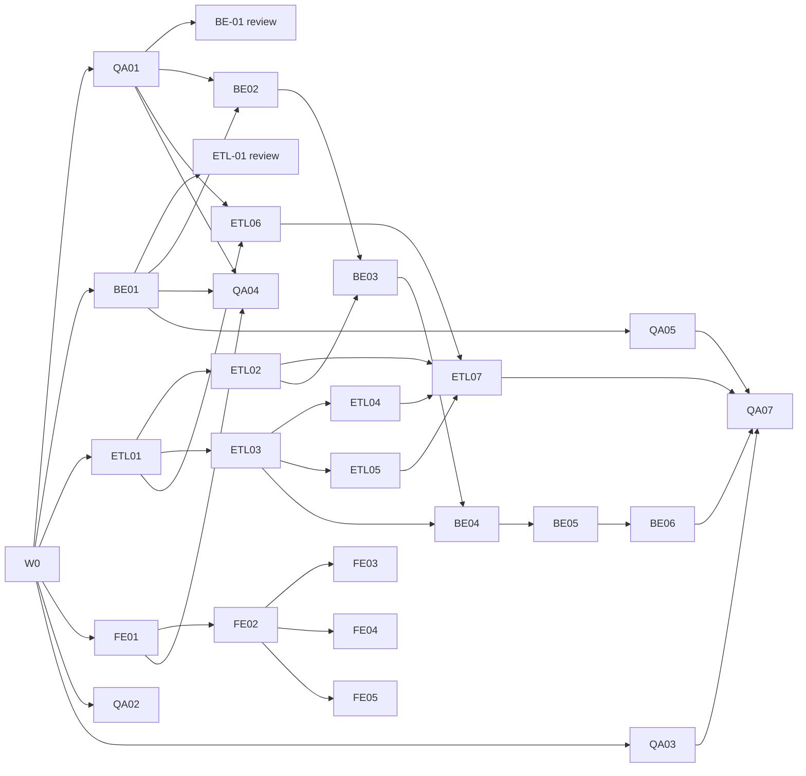

# LocalETL Task Board

Maintained by the orchestrator on `main` only. Agents never edit this file; they report status in their completion report.
Execution model: **Option B**, one Claude Code session per agent, each in its own Git worktree.

## Status legend

| Status | Meaning |
|---|---|
| Blocked | At least one dependency is not Done |
| Ready | All dependencies Done; may start |
| In progress | Agent working on it |
| In review | Branch submitted; awaiting QA verdict and orchestrator review |
| Done | Merged to `main`, full suite green on `main` |

A dependency is **Done only when its deliverables are merged to `main`**. "Before review" dependencies let coding start early but must be Done before the ticket can be submitted.

---

## Wave 0: Foundation (orchestrator)

| ID | Deliverable | Files | Acceptance criteria | Status |
|---|---|---|---|---|
| W0-01 | Project rules | `CLAUDE.md` | Mission, source-of-truth precedence, engineering rules, ownership, interface rules, git workflow, commands, completion report | Done (foundation commit) |
| W0-02 | Requirements | `docs/requirements.md` | Numbered REQ-01…REQ-64 covering every MVP scope item; limits; non-goals | Done (foundation commit) |
| W0-03 | Architecture + internal interfaces | `docs/architecture.md`, `.env.example` | Components, toolchain, ownership table, import rules, env vars, ETL engine interface (§5), semantic config rules (§6), DB schema + run state machine (§7) | Done (foundation commit) |
| W0-04 | Pipeline config contract | `contracts/pipeline.schema.json`, `contracts/examples/pipeline/{valid,invalid}/` | Draft 2020-12; fixed op and rule enums; 3 valid and 8 invalid examples behave as labelled | Done (foundation commit) |
| W0-05 | HTTP contract | `contracts/openapi.yaml` | OpenAPI 3.1, 22 operations, shared `Error`; references pipeline schema instead of duplicating it; Redocly lint 0 errors; `openapi-typescript` generates types | Done (foundation commit) |
| W0-06 | Specialist agents | `.claude/agents/*.md` (6) | Frontmatter on line 1; owned paths match architecture §3 | Done (foundation commit) |
| W0-07 | Task board + assignments | `docs/task-board.md`, `docs/assignments/*.md`, `docs/wave-1-runbook.md` | Every ticket has owner, dependencies, files, acceptance criteria, status | Done (foundation commit) |
| W0-08 | Consistency check | `contracts/tools/check_contracts.py`, `.gitignore` | Cross-checks enums, refs, examples, required fields and ownership across contracts and docs; 0 failures | Done (foundation commit) |

Foundation commit: see "Foundation record" at the end of this file.

---

## Wave 1: Core implementation

Owners: ETL → `etl-engineer` (worktree `agent-etl`), BE → `backend-engineer` (`agent-backend`), FE → `frontend-engineer` (`agent-frontend`), QA → `qa-engineer` (`agent-qa`).
Wave 2 (worker, visualization, browser E2E) is listed at the end and is not assigned yet.

### ETL engine: `backend/app/etl/`, `backend/tests/etl/`

| ID | Title | Depends on | Files to modify | Acceptance criteria | Status |
|---|---|---|---|---|---|
| ETL-01 | Public types, errors and interface stubs | W0 · *before review:* BE-01 | `backend/app/etl/__init__.py`, `types.py`, `errors.py`; `backend/tests/etl/test_public_api.py` | Every name in architecture §5 exported with exact signatures and full type hints (functions may raise `NotImplementedError`); dataclasses frozen; test asserts the export list; `mypy --strict backend/app/etl` passes; import-rule test (no FastAPI/`app.*` imports); **Row accounting (Q3, architecture §5):** `RunResult` has exactly `extracted_count, loaded_count, rejected_count, duplicate_dropped_count, null_dropped_count` before `rejected_sample`; new public `RunCounters` (same five fields, same order); `StageEvent` gains a final field `counters: RunCounters`; export-list and field-order tests updated | **Done**: merged `0253f17` (rebased code commit `f1328c5`, was `dd6c370`; checkpoint commit `04b4b3a` not merged). Interface design approved by user 2026-10-20 |
| ETL-02 | CSV inspect and preview | ETL-01, Q4, ETL-03b, QA-03c | `backend/app/etl/extract.py`, `backend/tests/etl/test_extract.py` | `inspect_csv` / `preview_csv` per §5; all 4 encodings and 4 delimiters; `has_header=false` naming; type inference for all 6 `ColumnType`s; `CsvFormatError` for every REQ-04 case; chunked reading; **CSV structure (Q4, approved 2026-10-20; architecture §5 "CSV structure and malformed input"):** empty or duplicate headers → `CsvFormatError` naming the position(s); unterminated quote, field > 131,072 chars and undecodable bytes anywhere → `CsvFormatError` from `inspect_csv` (full streaming pass); `row_count` counts every data record incl. malformed, excludes blank lines; preview, type inference and `null_count` use well-formed records only (Q4-c); without a header the expected width is the first record's (Q4-d); short rows never padded, columns never shifted (test: trailing delimiter on the first data row); tokenizing resumes after a recoverable quoting fault; a chunk iterator (for ETL-07) yields well-formed records plus `parse_error` `RejectedRow`s (`column = null`, `value` = fields joined with the delimiter, ≤ 500 chars) with global row numbers, never splitting a record; stdlib `csv.reader(strict=True)`, no new dependency; every `formats` entry in `tests/fixtures/expected.json` (after QA-03c) behaves as labelled | Blocked (ETL-03b shared casting functions for type inference, QA-03c fixtures; Q4 approved 2026-10-20); **Casting (Q6-3):** type inference uses the shared `casting.py` (A) rules, order integer → float → boolean → date → datetime → string, no `format` | **Done**: merged `4cd8cdd` (`833b87a` + `22d5dfb`; QA PASS `1458de0`) |
| ETL-03 | Config validation | ETL-01 | `backend/app/etl/config.py`, `backend/tests/etl/test_config.py` | Loads `contracts/pipeline.schema.json` from the path in §5; all examples in `contracts/examples/pipeline/` behave as labelled; each semantic rule in §6 has a passing and a failing test; errors collected with JSON Pointer paths | **Done**: merged `3091750` (code commit `0f56443`, QA PASS `d357794`; Q6-1 resolved by contract `f42db38`) |
| ETL-03b | Shared casting functions; align ETL-03 with Q6-3 | ETL-03, Q6-3 | `backend/app/etl/casting.py` (new), `backend/app/etl/config.py`, `backend/tests/etl/test_casting.py` (new), `backend/tests/etl/test_config.py` | `casting.py` implements architecture §5 "Value casting" (A) CSV cells and (B) config scalars exactly, with a test per table row and per general rule; ETL-03's castability check and range-bound parsing use it; fixes the 6 listed differences (ASCII-only digits, `bigint` range, strict ISO without `format` and no offsets, ISO config dates (C-b), JSON strings for string columns (C-c), §6 rule 7 directive check (C-e)); `fill_null`/`allowed_values`/`range` on integer columns must be integral; all contract examples still behave as labelled; no export changes; `mypy --strict` | **Done**: merged `fbbb4ed` (`b46e3fb`; QA PASS `9cef897`) |
| ETL-04 | Transform stage | ETL-03, ETL-03b | `backend/app/etl/transform.py`, `backend/tests/etl/test_transform.py` | Column select/rename; casting per §5 stage 2 with `type_cast`/`not_null` rejections; ordered registry with exactly the 7 schema ops (completeness test against the schema enum); `deduplicate` across chunks; no `eval`/`exec`/`DataFrame.query`/`DataFrame.eval`; **Row accounting (Q3, architecture §5):** cast and `nullable` failures count in `rejected_count`; `deduplicate` → `duplicate_dropped_count`, `drop_null_rows` → `null_dropped_count`, never `rejected_count`; first removal wins (test: `nullable: false` + `drop_null_rows` on the same column → rejected); dedupe keeps the first occurrence across chunk boundaries (test with `chunk_rows=2` and duplicates split across chunks); **Casting (Q6-3, approved 2026-10-20; architecture §5 "Value casting"):** stage 2(b) uses only the shared `casting.py` functions; one test per row of the casting table (accepted and rejected examples) and per general rule 1–4; C-a whitespace-only → null; C-d one `type_cast` entry per invalid cell, row counted once; `type_cast` entry `column` = target name, `value` = raw cell; typed output uses object or nullable dtypes so integer columns with nulls never become float (QA note on ETL-05); **Q7-3:** under `fail_run`, the chunk is evaluated before raising | **Done**: merged `55e70d5` (`325d8c7`; QA PASS `eb4b62a`). Open (Q9): transform semantics 1–9 |
| ETL-05 | Validate stage | ETL-03 | `backend/app/etl/validate.py`, `backend/tests/etl/test_validate.py` | Exactly the 6 schema rules (completeness test); one rejection per failing rule; `unique` across chunks; `fail_run` and `max_rejected_ratio` raise `RejectionLimitExceeded`; regex length cap; **Row accounting (Q3, architecture §5):** a row failing several rules counts once in `rejected_count` with one entry per rule; `unique` passes the first occurrence and rejects later ones across chunks; ratio = `rejected_count / extracted_count` (test: dropped rows do not raise the ratio) | **Done**: merged `5e5965f` (`b53562e` + rework `0c009f0`; QA PASS `79f25b0`, re-review `6e18c73`) |
| ETL-06 | Load and publish | ETL-01, QA-01 | `backend/app/etl/load.py`, `backend/tests/etl/test_load.py`, `backend/tests/etl/conftest.py` | Staging table `staging.run_<hex>`; type mapping §7.3 plus `_localetl_*` columns; `replace` and `append` publish in one transaction; append mismatch raises `LoadError`; failure leaves published table unchanged; identifiers validated and quoted; values bound; tests on `TEST_DATABASE_URL` (fixture creates `staging`/`datasets` schemas) incl. hostile names | **Done**: merged `7c88f1c` (`91c0aa5`; QA PASS `fe24937`). Open (Q8): `_localetl_` prefix §6 rule; replace lock / `lock_timeout`; append compatibility is order-sensitive |
| ETL-07 | `run_pipeline` | ETL-02, ETL-04, ETL-05, ETL-06 | `backend/app/etl/runner.py`, `backend/tests/etl/test_runner.py`, `backend/app/etl/errors.py` (`EtlError.rejected_sample`, Q11-c), `backend/tests/etl/test_public_api.py` (if the attribute is asserted) | Stage order and events per §5; `should_stop` raises `RunInterrupted` and drops staging; **Row accounting (Q3, architecture §5):** for every succeeded run `extracted_count = loaded_count + rejected_count + duplicate_dropped_count + null_dropped_count`, asserted before publish (violation raises `EtlError`, nothing published); identity holds after every chunk; identical counters for `chunk_rows` ∈ {1, 2, 7, 50 000} on the QA-03 fixtures; every `StageEvent.counters` is cumulative and never decreases, at least one `progress` event per chunk, and the final event's counters equal `RunResult`; on failure/interrupt the last event's counters satisfy the chunk invariant and `loaded_count = 0`; matches every count in `tests/fixtures/expected.json`; first 1,000 rejections kept; never writes `public.*`; usable from a plain script (example in module docstring); **Q4:** `parse_error` rows count in `extracted_count` and `rejected_count`; ragged fixtures give identical counters for `chunk_rows` ∈ {1, 2, 7, 50 000}; a file-level fault in chunk *k* fails the run at `extract` with counters from chunks before *k* and nothing published; under `fail_run` the first rejection of any kind fails the run (Q4-b); **Q7-3:** counters, events and rejections persisted only for completed chunks; a `fail_run` failure never reports the failing chunk as completed; **Q11 (approved 2026-10-20):** (a) under `fail_run` the earliest stage in pipeline order raises for a chunk; (b) interruption → `failed` event with message `interrupted`, then `RunInterrupted`; four `progress` events per completed chunk (extract, transform, validate, load), none for an incomplete chunk; (c) every raised `EtlError` carries `rejected_sample` (≤ 1,000, completed chunks only, row order); tested | **Done**: merged `fabd970` (`05ea98e`; QA PASS `85f2268`) |

### Backend API: `backend/app/{main.py,core,api,models,schemas}`, `backend/migrations/`, `backend/tests/{api,models}/`

| ID | Title | Depends on | Files to modify | Acceptance criteria | Status |
|---|---|---|---|---|---|
| BE-01 | Project scaffold, settings, errors, health | W0 · *before review:* QA-01 | `backend/pyproject.toml`, `backend/app/__init__.py`, `backend/app/main.py`, `backend/app/core/{settings,db,errors}.py`, `backend/app/api/__init__.py`, `backend/app/api/health.py`, `backend/tests/conftest.py`, `backend/tests/api/test_health.py`, `backend/tests/api/test_errors.py` | pyproject declares exactly the libs in architecture §2 (others justified); `pip install -e '.[dev]'` works on Python 3.11; settings from env only; `/api/v1/health` reports `database: ok` against Postgres and `unavailable` when down; 422/404 bodies use contract `Error`; pytest + mypy pass | **Done**: merged `a174f4c` (branch `d45b8c6`) |
| BE-01b | 405 → `method_not_allowed` (decision Q1) | BE-01, contract `b8c6c8f` | `backend/app/core/errors.py`, `backend/tests/api/test_errors.py` | HTTP 405 returns `Error` with `code: method_not_allowed` and the `Allow` header preserved; other unmatched 4xx unchanged; test for `DELETE /api/v1/health`; pytest, mypy, ruff pass | **Done**: merged `68c0ec6` (branch `3c1ca17`) |
| BE-02 | Metadata models and migrations | BE-01, QA-01 | `backend/app/models/*.py`, `backend/alembic.ini`, `backend/migrations/**`, `backend/tests/models/test_migrations.py` | Tables, enum, indexes and FKs exactly per §7.1 (including schemas `staging`, `datasets`); `alembic upgrade head` / `downgrade base` on empty DB; tests prove both partial unique indexes reject a second running run and a second active run per pipeline; **Row accounting (Q3, architecture §5):** five counter columns per §7.1; tests prove the CHECK rejects a `succeeded` run whose counters don't reconcile and a non-succeeded run with `loaded_count > 0` | **Done**: merged `ad52a78` (rebased code commit `b4cd94c`, was `f752a0f`; checkpoint commit `83e1e6c` not merged) |
| BE-03 | Sources endpoints | BE-02, ETL-02 | `backend/app/api/sources.py`, `backend/app/schemas/sources.py`, `backend/tests/api/test_sources.py` | `POST/GET /sources`, `GET/DELETE /sources/{id}`, `GET /sources/{id}/preview` match the contract exactly; streamed upload with 413 before full write; server-generated path `sources/<id>.csv`; 415/422 cases; delete 409 when referenced; uses `app.etl` public names only; **Q4:** every `CsvFormatError` (incl. empty/duplicate headers and unrecoverable structure) → 422 `validation_error` carrying its message, temp file deleted, no source row | **Done**: merged `ce31914` (octopus with QA-05b `5e502c0`; QA PASS `8655e38`). Open (contract proposal): undeclared 422 on getSource/deleteSource, undeclared 500 on previewSource |
| BE-04 | Pipelines endpoints | BE-03, ETL-03 | `backend/app/api/pipelines.py`, `backend/app/schemas/pipelines.py`, `backend/tests/api/test_pipelines.py` | CRUD + `POST /pipelines/validate` per contract; validation via `validate_pipeline_config(..., source_columns=...)` only; `config_version` increments on PUT; duplicate name 409; delete with active run 409; `last_run` populated; error paths: `validate_pipeline_config` returns paths relative to the config (`/transformations/2/columns`); the API must prefix `/config` so every `ErrorDetail.path` is a JSON Pointer into the request, per the contract (`/config/transformations/2/columns`), for both `POST /pipelines/validate` results and 422 bodies; tested | **Done**: merged `af90757` (octopus with QA-05c `6a64cfa`; QA PASS `b5e1d2e`) |
| BE-05 | Runs endpoints | BE-04 | `backend/app/api/runs.py`, `backend/app/schemas/runs.py`, `backend/tests/api/test_runs.py` | `POST /pipelines/{id}/runs` returns 202 `queued` with snapshot, never executes; 409 on second active run; `GET /runs` filters + pagination; `/runs/{id}`, `/events`, `/rejections` per contract; **Row accounting (Q3, architecture §5):** `Run` returns `extracted_count`, `loaded_count`, `rejected_count`, `duplicate_dropped_count`, `null_dropped_count`; `/rejections` pages entries (a row may have several) | **Done**: merged `29d810b` (octopus with QA-05d `2ecdbdb`; QA PASS `e4ee1aa`) |
| BE-06 | Datasets and metrics endpoints | BE-05 | `backend/app/api/datasets.py`, `backend/app/api/metrics.py`, `backend/app/schemas/{datasets,metrics}.py`, `backend/tests/api/test_datasets.py`, `backend/tests/api/test_metrics.py`, `backend/tests/api/test_contract_drift.py` | `/datasets`, `/datasets/{id}`, `/rows` (sort validated against registry columns), `/profile`, `/metrics/summary` (zero-filled days; `loaded_count_total` and daily `loaded_count` sum succeeded runs only); `_localetl_*` hidden; drift test: served OpenAPI matches `contracts/openapi.yaml` for all 22 operations | **Done**: merged `7b46edb` (octopus with QA-05e `3c57493`; QA PASS `24f45bf`) |

### Frontend: `frontend/` (except `src/features/analytics/`, `src/features/explorer/`)

| ID | Title | Depends on | Files to modify | Acceptance criteria | Status |
|---|---|---|---|---|---|
| FE-01 | Scaffold and app shell | W0 | `frontend/package.json`, `vite.config.ts`, `tsconfig*.json`, `tailwind.config.ts`, `postcss.config.js`, `eslint.config.js`, `index.html`, `src/main.tsx`, `src/app/**` (router, layout, providers, design tokens), `src/test/setup.ts` | Libs per architecture §2 (Recharts installed for Wave 2); TS strict; routes Sources, Pipelines, Runs, Datasets (placeholder), Home; `npm ci`, `test`, `lint`, `build`, `tsc --noEmit` pass | **Done**: merged `ddf63ea` (code commit `27d9ed3`; checkpoint commit `8d0886f` not merged) |
| FE-02 | Generated types, API client, typed mocks | FE-01 | `src/app/api/schema.d.ts` (generated), `src/app/api/client.ts`, `src/app/api/fixtures/**`, `src/app/api/*.test.ts` | Types generated from `contracts/openapi.yaml` with the command in CLAUDE.md; one function per operation used by FE tickets; `Error` body surfaced as typed error; base URL `VITE_API_URL`; mock fixtures typed against generated types; also fix the FE-01 `typecheck` script (F5) | **Done**: merged `2497009` (`dde00b6` + regen `4890451`; QA PASS `a026d8d`/`b554066`, re-check `c56c244`) |
| FE-02r | Regenerate `schema.d.ts` after Q4 and Q6-3/Q7 contract descriptions | FE-02, Q4, Q6-3 | `frontend/src/app/api/schema.d.ts` | Generated with the CLAUDE.md command only; diff limited to `@description` comments; byte-identical to generation from `main`'s contract | **Done**: merged `3d77e8b` (`f91bd0a`; QA narrow check `54df211`) |
| FE-03 | Sources: upload and preview | FE-02 | `src/pages/sources/**`, `src/components/sources/**` | Upload with CSV options form and client size check; list with pagination; preview table rendered as text; loading/empty/error states; tests | **Done**: merged `f7806b2` (`3eb10ab`; QA PASS; config blocker resolved by `c87b048`, Q8-1) |
| FE-04 | Pipeline builder | FE-02 | `src/features/pipelines/**`, `src/pages/pipelines/**` | Builds configs valid against the schema from a source's columns; offers only the 7 ops and 6 rules; reorderable transformations; client checks + `POST /pipelines/validate`, errors shown at their JSON Pointer path; create/edit/delete; tests using the contract examples; **Casting (Q6-3):** client checks mirror architecture §5 "Value casting" (config scalars B, C-b ISO dates, C-c strings, C-e format directives, integral bounds on integer columns); server validation stays authoritative and its errors are shown at their JSON Pointer path | **Done**: merged `744d3a8` (`3ed0183` fix on `60e1511`; QA PASS + re-check `34d45d7`). Open (low, Q8-8): integer range bounds > 2^53 sent as strings |
| FE-05 | Run controls, monitoring, history | FE-02 | `src/pages/runs/**`, `src/components/runs/**` | Run button (409 shown clearly); run detail with status, stage events, the five Q3 counters (`extracted_count`, `loaded_count`, `rejected_count`, `duplicate_dropped_count`, `null_dropped_count`; drops shown separately from rejections; live while running), rejections table; polling every 2 s that stops at terminal states; history list with pipeline/status filters; metrics as text (charts are Wave 2); tests incl. polling stop | **Done**: merged `cb9eaec` (`29d581b`; QA re-check `6c79131`) |

### QA: `tests/`, `scripts/`, `docs/qa/`, `.github/workflows/`, `docker-compose.yml`

| ID | Title | Depends on | Files to modify | Acceptance criteria | Status |
|---|---|---|---|---|---|
| QA-01 | Local dev stack | W0 | `docker-compose.yml`, `scripts/db/init.sql`, `scripts/dev-up.sh`, `scripts/README.md` | `docker compose up -d db` starts Postgres 16 on `127.0.0.1:5432` with healthcheck, creating `localetl` and `localetl_test` from `.env` values; data in a named volume; script waits for healthy | **Done** (`1595bd9`) |
| QA-02 | Test plan and traceability | W0 | `docs/qa/test-plan.md` | Every REQ-xx mapped to tests by layer and ticket; suite commands; Wave 1 exit criteria | **Done**: merged `f484ee8` (`3a7c3d6`; orchestrator review PASS). Provisional rows re-checked after Q4/Q6-3 approval |
| QA-02b | Test plan: resolve provisional rows | QA-02, Q4, Q6-3, Q7 | `docs/qa/test-plan.md` | Every row marked PROVISIONAL re-checked against the approved text (Q4 `a78870f`, Q6-3/Q7 merge) and either confirmed or corrected; Q7 rows added (null skipping, composite `unique` JSON value, `fail_run` checkpoints, `regex` internal error); section 6 baseline refreshed from `main`; no PROVISIONAL markers remain | **Done**: merged `f4d3f4e` (`d492358`; orchestrator review PASS) |
| QA-03 | Synthetic CSV fixtures | W0 | `tests/fixtures/csv/**`, `tests/fixtures/generate_large.py`, `tests/fixtures/README.md` | Clean orders file matching `orders_full.json`; empty; header-only; BOM; latin-1; `;` `\t` `\|`; ragged rows; duplicate headers; >500 columns; hostile column names; dirty values hitting every rule; large file generated, not committed | **Done**: merged `99858c4` (rebased `41f7ab5`, `6d97e94`, `a141eee`; checkpoint `fae7840` not merged); ragged/duplicate-header expectations replaced by QA-03c after Q4 |
| QA-03b | Fixtures: Q3 counters | QA-03, Q3 contract | `tests/fixtures/build_fixtures.py`, `tests/fixtures/expected.json`, `tests/fixtures/pipelines/*.json`, `tests/fixtures/test_fixtures.py`, `tests/fixtures/README.md` | `expected.json` uses `extracted_count, loaded_count, rejected_count, duplicate_dropped_count, null_dropped_count` for every scenario (no legacy `rows_*` keys); self-test asserts the identity for every succeeded scenario; **new scenario with `null_dropped_count > 0`** (`drop_null_rows` on a nullable column) and one where duplicates straddle a chunk boundary; regenerated output deterministic | **Done** (folded into QA-03, merged `99858c4`) |
| QA-03c | Fixtures: CSV structure (Q4) | QA-03, Q4 | `tests/fixtures/csv/**`, `tests/fixtures/build_fixtures.py`, `tests/fixtures/expected.json`, `tests/fixtures/pipelines/*.json`, `tests/fixtures/test_fixtures.py`, `tests/fixtures/README.md` | Replace the placeholder `formats` text with concrete expectations: `ragged_rows.csv` → 6 records, rows 2, 3, 5 `parse_error`, 3 well-formed; `duplicate_headers.csv` → `CsvFormatError` naming `id` (1, 5) and `name` (2, 3). New fixtures: empty header name (Q4-a); unterminated quote (file-level); stray quote after a closing quote (row-level, next row parses); trailing delimiter on the first data row; malformed records straddling a `chunk_rows=2` boundary; ragged without header incl. a malformed first record (Q4-d); multi-line quoted field counted as one record; blank lines mixed with ragged rows; a field > 131,072 chars generated in the test, not committed. One pipeline scenario with `parse_error` rows whose five counters reconcile, and one with `fail_run` failing on the first `parse_error` (Q4-b). README line on unspecified behaviour removed; rebuild deterministic | **Done**: merged `dd27bc9` (`6903502`; orchestrator review PASS, expectations re-derived independently). Open: `parse_error` value for quoting faults (user) |
| QA-03d | Fixture fix: `hostile_columns.csv` empty header | QA-03c, Q4-a | `tests/fixtures/**` | Column 15's empty header replaced by a non-empty hostile name (16 unique, non-empty names); `expected.json` labels it accepted with names verbatim and its row count; self-test asserts no empty header; rebuild deterministic | **Done**: merged `db9e633` (`8509f02`; orchestrator review PASS) |
| QA-04 | CI workflow | QA-01, BE-01, FE-01 | `.github/workflows/ci.yml`, `scripts/test-all.sh` | Runs contract check, Redocly lint, backend pytest (Postgres service) + mypy, frontend test/lint/build; `scripts/test-all.sh` runs the same locally | **Done**: merged `d1e0df9`; dev container recreated 2026-10-20 (`localetl-db-1`, same volume `localetl_localetl_pgdata`; databases intact; test-all 16/16 after) |
| QA-05 | API conformance harness | BE-01 · extended after each BE merge | `tests/integration/conftest.py`, `tests/integration/test_api_conformance.py` | Validates live responses (status + body) against `contracts/openapi.yaml` for every merged endpoint, including error bodies | **Done**: merged `b4c25d0` (`0d8e5d5`, `3ed5fe7`, `43bc20f`; orchestrator review PASS). Each BE-03..06 merge flips its operationIds from pending to covered |
| QA-06 | Review gate | each ticket In review | `docs/qa/reviews/<TICKET-ID>.md` | Per ticket: PASS/FAIL, suites run with counts, ownership check, CLAUDE.md rules check, defects with repro | Ongoing |
| QA-07 | Wave 1 integration (exit gate) | ETL-07, BE-06, QA-03, QA-05 | `tests/integration/test_wave1_flow.py` | Via API: upload fixture → preview → create pipeline → validate → queue run (`queued`, 409 on second). Direct `run_pipeline` on the same snapshot: `replace` and `append` row counts in `datasets.*` match fixture expectations; **Row accounting (Q3, architecture §5):** for every succeeded scenario the five counters equal `expected.json` and reconcile, and `SELECT count(*)` of the published rows written by the run equals `loaded_count`; failing pipeline publishes nothing; interrupted run drops staging; **Q4:** upload of `duplicate_headers.csv` → 422; a ragged fixture uploads, runs `succeeded`, and its `parse_error` rejections match `expected.json` | **Done**: merged `d8e957b` (`2c52cfc`; orchestrator review PASS: 35 tests, order-independent, mutation-checked) |

---

## Start readiness after the foundation commit

| Agent | Can resume now with | Then |
|---|---|---|
| etl-engineer | **ETL-01**: rebase + submit now | ETL-03 → ETL-02 → ETL-04/ETL-05 → ETL-06 (needs QA-01) → ETL-07 |
| backend-engineer | ~~BE-01~~ Done → **BE-01b**, then **BE-02** | BE-03 → BE-04 → BE-05 → BE-06 |
| frontend-engineer | **FE-01** | FE-02 → FE-03 / FE-04 / FE-05 |
| qa-engineer | **QA-01** first (unblocks DB work), then QA-03, QA-02 | QA-04, QA-05, QA-06 reviews, QA-07 |

All four agents can resume immediately. Every other ticket is Blocked until its dependencies merge.

Critical path: QA-01 → BE-01 → BE-02 → BE-03 → BE-04 → BE-05 → BE-06 → QA-07 (ETL-02/03 must land before BE-03/BE-04).

## Wave 2 (approved 2026-10-20; **complete 2026-10-21**)

Approved by the user 2026-10-20. Starts after the user launches `agent-worker` and `agent-viz` (see `docs/checkpoints/CHECKPOINT.md`). Hardening track deferred until Wave 2 core and QA are complete.

| ID | Title | Owner | Depends on | Files | Acceptance criteria | Status |
|---|---|---|---|---|---|---|
| WK-01 | Claim, heartbeat, recovery loop | worker-engineer | Wave 1 | `backend/app/worker/**`, `backend/app/services/runs/**`, `backend/tests/worker/**` | `python -m app.worker`; claim per §7.2 (`FOR UPDATE SKIP LOCKED`), back off on `one_running_run` violation; recovery of stale `running` at start and every poll; heartbeat/poll/stale from `WORKER_*` env; tests on throwaway DBs incl. two racing workers | **Done**: merged (code `97c3d58`; QA PASS `d37865e`; test-all 16/16). Proposal (non-blocking): move `WorkerConfig` to `app.core.settings` — backend-owned, deferred |
| WK-02 | Execute runs; success/failure transactions | worker-engineer | WK-01, ETL-07 | as WK-01 | `run_pipeline` with `config_snapshot`, source `csv_options`, path = `LOCALETL_DATA_DIR`/`stored_path` (relative), `chunk_rows` = `LOCALETL_CHUNK_ROWS`; per event: insert `run_events` + counters + `current_stage` + heartbeat in one transaction; success and failure transactions per §7.2 (registry upsert, `dataset_id`, rejections; failure uses `getattr(exc, "rejected_sample", [])`); unexpected exceptions → `failed` | **Done**: merged (code `b65d827`; QA PASS `e61cb90`; test-all 16/16). Note: crash after engine publish but before success txn leaves table published, run `failed` (inherent in §7.2; hardening) |
| WK-03 | Signal handling | worker-engineer | WK-02 | as WK-01 | SIGINT/SIGTERM: stop claiming, `should_stop` → `RunInterrupted` at the next boundary, status `interrupted`, clean exit (REQ-44) | **Done**: merged (code `e8dc6a4`; QA PASS `5dbb1bd`; test-all 16/16) |
| VIZ-01 | Run metrics charts | visualization-engineer | Wave 1 | `frontend/src/features/analytics/**` | Recharts: run outcomes per day by status, rows loaded per run, from `/metrics/summary` and `/runs` via the FE-02 client; loading/empty/error states; tests (REQ-52, REQ-55) | **Done**: merged (code `f6e22b1`; QA PASS `32977a1`; test-all 16/16) |
| VIZ-02 | Dataset explorer with profile charts | visualization-engineer | Wave 1 | `frontend/src/features/explorer/**` | Datasets list; rows table with paging and single-column sort (text rendering); per-column profile charts (top values, nulls) from `/profile`; tests (REQ-53..55) | **Done**: merged (code `1aedbe2`; QA PASS `394bbf7`; test-all 16/16). Non-blocking: rows table unmounts on page/sort (flash, focus loss); no profile/list error tests. Depends on VIZ-01; stacked on VIZ-01 and imports `features/analytics` (`ChartFrame`, `useApiData`, `format`), so **depends on VIZ-01**; review after VIZ-01 merges, diff vs VIZ-01 only |
| FE-06 | Mount VIZ screens | frontend-engineer | VIZ-01, VIZ-02 | `frontend/src/pages/datasets/**`, `src/pages/home/**`, `src/pages/runs/**`, `src/app/routes.tsx` | Explorer on Datasets page; charts on Home (amended 2026-10-21 per QA: Runs already shows the same metrics as text); routes + navigation; tests | **Done**: merged (code `e987eaf`; QA PASS `10f1213`; test-all 16/16). `src/test/setup.ts` ResizeObserver stub (frontend-owned, accepted); Recharts chunk > 500 kB (non-blocking) |
| QA-07b | QA-07 uses the real worker persistence | qa-engineer | WK-02 | `tests/integration/test_wave1_flow.py` | Replace the `worker_finish` stand-in with WK-02 code; suite green | **Done**: merged (code `491d3a7`; orchestrator review PASS; test-all 16/16) |
| QA-09 | Performance (REQ-61) | qa-engineer | WK-02 | `tests/perf/**` | 1M rows × 10 columns `replace` run < 5 min; memory bounded to ~one chunk; generated data never committed | **Done**: merged (code `74008e2`; orchestrator review PASS). Opt-in `LOCALETL_PERF=1`; one laptop run: 1M rows in 135 s, peak RSS flat (269 MB at 200k and 1M). Measures `run_pipeline`, not the worker's per-event transactions |
| QA-08 | Playwright E2E demo (MVP gate) | qa-engineer | WK-02, WK-03, FE-06 | `tests/e2e/**` (own `package.json` with `@playwright/test`), `scripts/` launcher | Full stack (Postgres, API, worker, frontend): upload → configure → run → monitor → results and charts; recorded video/trace kept in an ignored directory; CI job. **Playwright and the launcher script approved 2026-10-20; implementation deferred to this ticket** | **Done**: merged (code `3c7d1a3`; orchestrator review PASS; test-all 16/16). E2E 1/1 passed twice (QA, then orchestrator on the trial merge, 2026-10-21): real worker, exit 0 on SIGTERM, throwaway DB dropped. Recording: `tests/e2e/test-results/mvp-demo-MVP-demo-upload---8050d-results-explorer-and-charts-chromium/video.webm` (gitignored). Notes: Chromium only; spec checks extracted=200 and the reconciliation identity, not every `expected.json` counter; `e2e.yml` not yet run on GitHub |

Critical path: WK-01 → WK-02 → WK-03 → QA-08. VIZ-01/02 → FE-06 in parallel; QA-09 and QA-07b after WK-02.

Deferred (user, 2026-10-20) until Wave 2 core and QA are complete: hardening track for Q8-2..12, Q9, Q10, Q12-2/3.

## Wave 2 follow-ups (approved 2026-10-21)

| ID | Title | Owner | Files | Acceptance criteria | Status |
|---|---|---|---|---|---|
| VIZ-03 | Explorer polish | visualization-engineer | `frontend/src/features/explorer/**` | Rows table stays mounted during page/sort reload (no flash, focus kept); tests for datasets-list and profile error states; focus test | In progress: agent-viz, `viz/VIZ-03-explorer-polish` |
| QA-08b | E2E counters from fixture | qa-engineer | `tests/e2e/**` | All five run counters asserted against `tests/fixtures/expected.json`; explorer total = loaded | **Done**: merged (code `2e9cd0a`; orchestrator review PASS; test-all 16/16; E2E 1/1). Limitation: UI builds its own default pipeline, not `orders_full.json`, so counters match only because both load all 200 rows |
| QA-08c | First GitHub run of `e2e.yml` | qa-engineer | `.github/workflows/e2e.yml` | Workflow green on GitHub | **Blocked**: repo has no git remote; pushing needs user approval |

## Hardening track (DRAFT 2026-10-21, pending user approval)

Orchestrator recommendations. "Document" = confirm current behavior in architecture §6 (orchestrator, no code). "Fix" items become tickets after approval; items marked (env) would add an environment variable to `.env.example` (shared, needs approval).

| Item | Recommendation | Ticket |
|---|---|---|
| Q8-2 `_localetl_` column prefix | Fix: §6 rule rejecting target columns with that prefix (avoids collision with internal columns) | H-ETL-1 |
| Q8-3 replace-mode ACCESS EXCLUSIVE lock | Document as known limitation | — |
| Q8-4 unusable strptime formats | Fix: reject at config time | H-ETL-1 |
| Q8-5 quoting-fault `parse_error` value = raw record | Document | — |
| Q8-6 config ISO date strings not stripped | Fix: strip like numeric/boolean (consistency) | H-ETL-1 |
| Q8-7 empty config strings for numeric/boolean rejected | Document (current behavior correct) | — |
| Q8-8 string range bounds on number columns rejected | Document (§6 rule 4 stands) | — |
| Q8-9 `0`/`1` + `yes`/`true` infer boolean | Document | — |
| Q8-10 replace publish has no `lock_timeout` | Fix: `SET LOCAL lock_timeout` (fixed 5 s constant, no new env var) → `LoadError` | H-ETL-1 |
| Q8-11 append compatibility order-sensitive | Document as intended | — |
| Q8-12 faulty first record = file-level `CsvFormatError` | Document as Q4 rule 5 clarification | — |
| Q9 (1–7) transform semantics | Document all seven as implemented | — |
| Q10-1 dependency drift | Fix: `backend/constraints.txt` + pytest `filterwarnings` | H-QA-1 |
| Q10-2 lint `contracts/tools` | Fix the findings (orchestrator-owned path) | H-ORCH-1 |
| Q10-3 NUL byte fails the whole run at load | Fix: reject the row as `parse_error` | H-ETL-1 |
| Q10-4 preview succeeds on late-fault file | Document (preview is a sample) | — |
| Q10-5 whitespace-only header accepted | Fix: reject as `CsvFormatError` | H-ETL-1 |
| Q12-2 stale partial uploads in `tmp/` | Fix: clean at API startup | H-BE-1 |
| Q12-3 ETL-07 event-order notes | Document | — |
| WK-01 QA note: `WorkerConfig` → `app.core.settings` | Fix | H-BE-1 (backend) then worker import update |
| WK-02 QA note: crash between publish and success txn | Document as known limitation of §7.2 | — |
| FE-06 note: Recharts chunk > 500 kB | Fix: lazy-load Home and Datasets routes | H-FE-1 |

Proposed order (after approval): orchestrator §6 doc update first (H-ETL-1 depends on it) → H-ETL-1, H-BE-1, H-QA-1, H-FE-1 in parallel → QA review each → full suite + E2E at each merge.

## Review log

| Ticket | Branch / commits | Merge | Reviewer | Verdict | Evidence | Follow-ups |
|---|---|---|---|---|---|---|
| QA-01 | `qa/QA-01-dev-stack` @ `61573e6` | `1595bd9` | orchestrator (QA cannot review its own ticket) | PASS | `docker compose config` valid; contract check 0 failures; with `POSTGRES_PORT=55432` the stack was healthy in 6.6 s; `localetl` and `localetl_test` reachable over TCP immediately after healthy; port bound to `127.0.0.1` only; named volume; review stack torn down afterwards | F1, F2 |
| BE-01 | `be/BE-01-scaffold` @ `d45b8c6` (2 commits; identical code to `a2b98ba`) | **`a174f4c`** | qa-engineer (`docs/qa/reviews/BE-01.md`, `691a280`: PASS; first pass `53570a1`: changes requested, rebase only) + orchestrator | PASS | On the merged tree (`9009372`, identical to the committed `main` tree), fresh venv, Python 3.11.6, Postgres 16 on 55432: pytest 8 passed / 0 skipped (from `backend/` and repo root); mypy clean; ruff check + format clean; check_contracts 0 failures; live `/api/v1/health` → ok; unknown route → contract 404 | Q1 → BE-01b; F3 |
| BE-01b | `be/BE-01b-method-not-allowed` @ `3c1ca17` (1 commit; reviewed without rebase under the runbook exception) | **`68c0ec6`** | qa-engineer (`docs/qa/reviews/BE-01b.md`, `76240a8` on `qa/QA-06-reviews`: PASS) + orchestrator | PASS | Trial merge into `ebcd928`: 0 conflicts; check_contracts 0 failures; fresh venv, Python 3.11.6, Postgres 16 on 55432: pytest 9 passed / 0 skipped (from `backend/` and repo root; baseline `main` 8); mypy clean (8 files); ruff check + format clean | F4 |
| FE-01 | `fe/FE-01-scaffold` @ `27d9ed3` (code commit; tip `8d0886f` adds only the agent checkpoint file, not merged; reviewed without rebase under the runbook exception) | **`ddf63ea`** | qa-engineer (`docs/qa/reviews/FE-01.md`, `76240a8` on `qa/QA-06-reviews`: PASS) + orchestrator | PASS | Trial merge into `0d24f21`: 0 conflicts, 26 files all under `frontend/`; Node 23.7.0: `npm ci` OK; vitest 7 passed; eslint clean; `tsc --noEmit -p tsconfig.app.json` and `-p tsconfig.node.json` OK; `vite build` OK (209.75 kB JS / 7.46 kB CSS); check_contracts 0 failures; backend pytest 9 passed; `npm audit --omit=dev`: 2 moderate (react-router 6.x, known) | F5, F6 |
| ETL-01 | `etl/ETL-01-public-types` rebased onto `a07cbb0`: code commit `f1328c5` (range-diff identical to pre-rebase `dd6c370`; backup branch `etl/ETL-01-public-types-prerebase` @ `dcfc4d8`); tip `04b4b3a` adds only the agent checkpoint file, not merged | **`0253f17`** | user (interface design, 2026-10-20) + qa-engineer (`docs/qa/reviews/ETL-01.md`, `b0463ff` on `qa/QA-06-reviews`: independent re-review, PASS; supersedes the pre-Q3 review of `8b23e75`) + orchestrator | PASS | Trial merge into `a07cbb0`: 0 conflicts, 7 files all under `backend/app/etl/` and `backend/tests/etl/`; Python 3.11.6, Postgres 16 on 55432: check_contracts 0 failures; pytest 27 passed (ETL 18, API 9; from `backend/` and repo root); mypy app clean (14 files); mypy --strict app/etl clean (6 files); ruff check + format clean; `import app.etl` loads no FastAPI/pydantic/`app.*` modules; no parent-relative imports | F7 |
| BE-02 | `be/BE-02-models-migrations` rebased onto `7d2d7b6`: code commit `b4cd94c` (range-diff identical to `f752a0f`; backup branch `be/BE-02-models-migrations-prerebase` @ `2961361`); tip `83e1e6c` adds only the agent checkpoint file, not merged | **`ad52a78`** | qa-engineer (`docs/qa/reviews/BE-02.md`, `cc342c5` on `qa/QA-06-reviews`: PASS; own scratch-DB checks of both CHECKs and partial indexes via `pg_constraint`/`pg_indexes`) + orchestrator | PASS | Trial merge into `7d2d7b6`: 0 conflicts, 11 files all backend-owned; no value-interpolated SQL (only test-generated, quoted scratch DB names in `tests/models/conftest.py`); DB URL from settings/env only; Python 3.11.6, Postgres 16 on 55432: check_contracts 0 failures; pytest 56 passed (ETL 18, API 9, models 29); mypy clean (18 files); mypy --strict app/etl clean; ruff clean; alembic upgrade → downgrade → upgrade OK; `alembic check`: no drift; `localetl_test` left at base | F9 |
| ETL-03 | `etl/ETL-03-config-validation` @ `0f56443` (rebased onto `65b093f`, range-diff identical to `c85c504`; backup `-prerebase` @ `c85c504`); merged without a further rebase on user instruction (main had moved only by a board commit and contract `f42db38`, no file overlap) | **`3091750`** | qa-engineer (`docs/qa/reviews/ETL-03.md`, `d357794` on `qa/QA-06-reviews`: PASS, 6 needs-ruling items → Q6) + user (Q6-1 Option A) + orchestrator | PASS | Trial merge into `f42db38`: 0 conflicts, 2 files; check_contracts 0 failures; pytest 102 passed (ETL 64, API 9, models 29); mypy clean (18 files); mypy --strict app/etl clean; ruff clean; probe on the merged validator: `format` rejected at `/columns/0/format` for string/integer/float/boolean, accepted for date/datetime; no eval/exec/query; `app.etl` import isolation holds | Q6-2…6 |
| FE-02 | `fe/FE-02-api-client` rebased onto `9d550f4`: `dde00b6` (range-diff identical to `e6e0215`) + `4890451` (regenerated `schema.d.ts`, 2 comment lines); backup `-prerebase` @ `e6e0215`; merged without a further rebase (main moved only by board commit `d332355`) | **`2497009`** | qa-engineer (`docs/qa/reviews/FE-02.md`: PASS `a026d8d` + addendum `b554066`; re-check PASS `c56c244`) + orchestrator | PASS | Trial merge into `d332355`: 0 conflicts, 8 files all under `frontend/`; npm ci OK; vitest 19 passed; eslint clean; typecheck (app + node) clean; vite build OK; `schema.d.ts` identical to generation from current contract; check_contracts 0 failures; audit: 2 moderate (F6) | F5 closed |
| QA-03 | `qa/QA-03-fixtures` rebased onto `d332355`: `41f7ab5`, `6d97e94`, `a141eee` (range-diff identical to `8d0c14c`, `e3d2317`, `8b3ba0e`); checkpoint `fae7840` not merged; backup `-prerebase` @ `8a9fb50` | **`99858c4`** | orchestrator (QA cannot review its own ticket) | PASS | Review at `8b3ba0e`: scope `tests/fixtures/` only; 20 self-tests; rebuild byte-identical; 6 fixture pipelines pass merged ETL-03 validator; five Q3 keys + identity in every succeeded scenario; chunk-straddle/null-drop correct; `type_cast` rows identical under lax and draft-strict casting. Trial merge into `2497009`: 36 files, 0 conflicts; fixtures 20 passed; rebuild leaves tree unchanged; check_contracts 0 failures; backend pytest 102 passed | QA-03c (Q4) |
| QA-02 | `qa/QA-02-test-plan` @ `3a7c3d6` (from `9d550f4`; 1 file) | **`f484ee8`** | orchestrator (QA cannot review its own ticket) | PASS | All 36 REQs mapped by layer and ticket; Q4/Q6-3 rows provisional with branch + commit; commands match CLAUDE.md; exit criteria = runbook + drift/regen; trial merge 0 conflicts; check_contracts 0 failures; tables well-formed | baseline section stale (non-blocking) |
| QA-03c | `qa/QA-03c-csv-structure` @ `6903502` (from `6c5ee43`; 20 files, all `tests/fixtures/`) | **`dd27bc9`** | orchestrator (QA cannot review its own ticket) | PASS | Expectations re-derived with an independent stdlib `csv(strict)` tokenizer per §5 Q4: all file-level faults, record counts and `parse_error` row numbers match (incl. Q4-d headerless first-short, `chunk_rows=2` straddle); `fail_run` counters follow Q7-3; fixtures 43 passed; rebuild unchanged; check_contracts 0 failures; backend 102 passed | `parse_error` value for quoting faults (user) |
| QA-05 | `qa/QA-05-api-conformance`: `0d8e5d5`, `3ed5fe7` (range-diff identical to `c4cf4c5`, `cab8246`) + `43bc20f` (import sort); backup `-prerebase` @ `cab8246` | **`b4c25d0`** | orchestrator (QA cannot review its own ticket) | PASS | First attempt aborted on ruff I001 (cwd-dependent first-party detection; tooling fix `2d6bc1a`). Final: 2 files; 22 operationIds in COVERAGE (1 covered, 21 pending with ticket); throwaway DBs, none left; check_contracts 0 failures; backend + integration + fixtures 178 passed / 21 skipped; ruff clean from `backend/` and root | per-BE-merge coverage flips |
| ETL-03b | `etl/ETL-03b-shared-casting` @ `b46e3fb` (rebased on `0961252`; backup `-prerebase` @ `df82c78`); merged without a further rebase (main moved by board, QA-03c, QA-05; no overlap) | **`fbbb4ed`** | qa-engineer (`docs/qa/reviews/ETL-03b.md`, `9cef897`: PASS, ~290 independent spec cases) + orchestrator (decision-brief probe) | PASS | Trial merge into `da1d49d`: 4 files; check_contracts 0 failures; backend 313 passed (ETL 275); all 9 fixture pipelines valid; backend + integration + fixtures 389 passed / 21 skipped; mypy (19) and mypy --strict app/etl (7) clean; ruff clean | Q8 |
| ETL-06 | `etl/ETL-06-load-publish` @ `91c0aa5` (rebased on `838661b`; backup `-prerebase` @ `226aa4e`); merged without a further rebase (no file overlap) | **`7c88f1c`** | qa-engineer (`docs/qa/reviews/ETL-06.md`, `fe24937`: PASS with own scratch-DB probes) + orchestrator | PASS | Trial merge into `a122a26`: 3 files; check_contracts 0 failures; backend 369 passed; combined 445 passed / 21 skipped; mypy (20) and mypy --strict app/etl (8) clean; ruff clean from `backend/` and root; no leftover databases | Q8-2/3, lock_timeout, append order |
| ETL-04 | `etl/ETL-04-transform` @ `325d8c7` (backup `-prerebase`); no overlap | **`55e70d5`** | qa-engineer (`docs/qa/reviews/ETL-04.md`, `eb4b62a`: PASS) + orchestrator | PASS | scripts/test-all.sh 16/16 (backend 497); real extract → transform on orders_dirty: rejected 8, duplicates 3, identical for chunk_rows 1/7/50000 | Q9 |
| ETL-05 | `etl/ETL-05-validate-stage`: `b53562e` (= `79f25b0`) + `0c009f0` rework; backup `-prerebase` @ `79f25b0` | **`5e5965f`** | qa-engineer (`docs/qa/reviews/ETL-05.md`: PASS `79f25b0`; re-review PASS `6e18c73`) + orchestrator | PASS | scripts/test-all.sh 16/16 (backend 540); extract → transform → validate reproduces expected.json for orders_dirty_reject and orders_dirty_unique at chunk_rows 1/7/50000 | none |
| FE-04 | `fe/FE-04-pipeline-builder`: 5 commits range-diff identical to reviewed `60e1511` + fix `3ed0183`; backups `-prerebase`, `-prerebase2`, `-prerebase3` | **`744d3a8`** | qa-engineer (`docs/qa/reviews/FE-04.md`: PASS with 2 low defects; re-check PASS `34d45d7`) + orchestrator | PASS | scripts/test-all.sh 16/16 (frontend 103); 19 files all `frontend/`; no HTML sinks | Q8-8 string bounds |
| BE-03 + QA-05b | `be/BE-03-sources` @ `0391c81` + `qa/QA-05b-sources` @ `5e502c0` (octopus; each alone fails the coverage test) | **`ce31914`** | qa-engineer (BE-03: `docs/qa/reviews/BE-03.md`, `8655e38` PASS) + orchestrator (QA-05b) | PASS | scripts/test-all.sh 16/16 (backend 590, fixtures 46, integration 65 passed / 16 skipped) | contract: 422/500 declarations |
| FE-05 | `fe/FE-05-runs`: `934c4b0`, `baf4ec7` (= reviewed) + fix `29d581b`; backups `-prerebase`, `-prerebase2` | **`cb9eaec`** | qa-engineer (`docs/qa/reviews/FE-05.md`: CHANGES REQUESTED `57bea9f`; re-check PASS `6c79131`) + orchestrator | PASS | scripts/test-all.sh 16/16 (frontend 122); 13 files all `frontend/`; no HTML sinks | none |
| ETL-07 | `etl/ETL-07-runner` @ `05ea98e` (backup `-prerebase`) | **`fabd970`** | qa-engineer (`docs/qa/reviews/ETL-07.md`, `85f2268`: PASS, own throwaway-DB runs) + orchestrator | PASS | scripts/test-all.sh 16/16 (backend 657) | Q12-3 |
| BE-04 + QA-05c | `be/BE-04-pipelines` @ `e3ae0b2` + `qa/QA-05c-pipelines` @ `6a64cfa` (octopus) | **`af90757`** | qa-engineer (BE-04: `docs/qa/reviews/BE-04.md`, `b5e1d2e` PASS) + orchestrator (QA-05c) | PASS | scripts/test-all.sh 16/16 (backend 704, integration 99 passed / 10 skipped) | Q12-1 (422 declarations) |
| BE-05 + QA-05d | `be/BE-05-runs` @ `a1ff51c` + `qa/QA-05d-runs` @ `2ecdbdb` (octopus) | **`29d810b`** | qa-engineer (BE-05: `docs/qa/reviews/BE-05.md`, `e4ee1aa` PASS) + orchestrator (QA-05d) | PASS | scripts/test-all.sh 16/16 (backend 727, integration 115 passed / 5 skipped) | Q12-1 |
| BE-06 + QA-05e | `be/BE-06-datasets-metrics` @ `37c8915` + `qa/QA-05e-datasets` @ `3c57493` (octopus) | **`7b46edb`** | qa-engineer (BE-06: `docs/qa/reviews/BE-06.md`, `24f45bf` PASS, drift test mutation-checked) + orchestrator (QA-05e) | PASS | scripts/test-all.sh 16/16 (backend 764, integration 137 passed / 0 skipped) | Q12-1; drift scope |
| QA-07 | `qa/QA-07-wave1-flow` @ `2c52cfc` (1 file) | **`d8e957b`** | orchestrator (QA cannot review its own ticket) | PASS | scripts/test-all.sh 16/16 (integration 172 passed / 0 skipped); both file orders pass; orchestrator mutation (unique forgets keys between chunks) caught by exactly the cross-chunk cases | QA-05f conftest engine cache |

| ID | Follow-up | Owner | Blocking? |
|---|---|---|---|
| F1 | **This machine runs Postgres.app 13 on `127.0.0.1:5432`**, so `scripts/dev-up.sh` fails with "address already in use" on defaults (verified). Fix locally: either quit Postgres.app, or create `.env` with `POSTGRES_PORT=55432` and change the port in `DATABASE_URL`/`TEST_DATABASE_URL` to 55432. A misconfigured client fails loudly (`role "localetl" does not exist`), not silently. | user / every agent | Yes, for any DB test on this machine |
| F3 | Observed 2026-10-20: fresh installs resolved fastapi 0.155.0 then 0.156.1 the same day. `backend/pyproject.toml`: no upper bounds on `python-multipart`, `ruff`, `pandas-stubs`; no lockfile (fresh installs get the newest FastAPI/SQLAlchemy). Now orchestrator-owned; revisit with QA-04 CI | orchestrator | No |
| F2 | **Closed `d1e0df9`** (QA-04). Healthcheck uses socket `pg_isready`. During first-volume init the image's temporary server is socket-only, so `healthy` could precede `init.sql`. Not reproduced (window ≈ 0.3 s), but change to `pg_isready -h 127.0.0.1 ...` | qa-engineer (with QA-04) | No |
| F4 | pytest shows `StarletteDeprecationWarning` ("Using `httpx` with `starlette.testclient` is deprecated") with the unpinned FastAPI 0.155 / Starlette resolved on 2026-10-20; present on `main` before BE-01b. Pin or migrate with F3 | orchestrator (with QA-04) | No |
| F5 | **Closed: fixed in FE-02, merged `2497009`.** FE-01 `npm run typecheck` (`tsc --noEmit -p .`) type-checks nothing because root `tsconfig.json` is a solution file; use `tsc -b` or `-p tsconfig.app.json` (QA finding, low) | frontend-engineer (FE-02) | No |
| F6 | `npm audit --omit=dev`: 2 moderate react-router 6.x advisories (open redirect via backslash in `<Link>`/`useNavigate`; SSR `deserializeErrors`). Fix requires Router 7 (breaking). No SSR and no API-derived link targets yet; revisit before FE tickets build links from API data | orchestrator | No |
| F7 | `test_import_rules` skips all relative imports (level > 0), so `from ..models import X` would pass while breaking the import rule. No violation today (verified). Reject level ≥ 2 in the test (QA finding, low) | etl-engineer (with ETL-03) | No |
| F8 | **Closed `d1e0df9`** (QA-04; project name pinned `localetl`). `docker-compose.yml` hard-coded `container_name: localetl-db`, so a `COMPOSE_PROJECT_NAME=localetlreview` review stack cannot run beside the dev stack. Reviews currently share the dev stack on 55432 sequentially. Drop `container_name` | qa-engineer (with QA-04) | No |
| F9 | **Closed `d1e0df9`** (CI role is the image superuser). Model tests create scratch databases, so the DB role needs `CREATEDB` (true for the compose superuser; must hold for the CI Postgres service). Info notes from QA: no non-negative CHECK on counters (not required by §7.1); `Run.status` default is server-side only | qa-engineer (QA-04) | No |
| F10 | **Closed `bf526c2`** (pyyaml, openapi-spec-validator in the dev extra). `contracts/tools/check_contracts.py` imports `yaml` and `openapi_spec_validator`, but neither is declared anywhere; every agent installs them ad hoc. Resolve with the QA-05 dependency decision | orchestrator | No |
| F11 | **Closed for `tests/` (`d1e0df9`); `contracts/tools/check_contracts.py` still unlinted (32 findings, orchestrator).** `tests/` was not linted: `ruff check --config backend/pyproject.toml tests/fixtures` reports 3 E501 in `build_fixtures.py` (lines 17, 24, 28; from QA-03). Ruff import classification fixed in `2d6bc1a` (`known-first-party = ["app"]`) | qa-engineer (QA-04) | No |

## Agent status snapshot (superseded)

**Current state: see `docs/checkpoints/SESSION_HANDOFF.md` (2026-10-19 session end).** The table below is historical.

### 2026-10-19, after BE-01 merge

Verified from git and local session metadata. Test results are **agent-reported** until a reviewer re-runs them.

| Agent | Worktree | Branch @ commit | Ticket | Rebased on `main` | Files outside owned paths | Agent-reported tests |
|---|---|---|---|---|---|---|
| backend-engineer | `agent-backend` | `be/BE-01-scaffold` @ `d45b8c6` | BE-01 → **merged `a174f4c`** | n/a | none (14 files) | verified by QA and orchestrator (see Review log) |
| etl-engineer | `agent-etl` | `etl/ETL-01-public-types` @ `6a87211` | ETL-01 | **no** (needs rebase onto `b8c6c8f`+) | none (7 files) | pytest 17 passed; mypy --strict clean (temporary venv) |
| frontend-engineer | `agent-frontend` | `fe/FE-01-scaffold` @ `41efb4b` | FE-01 | **no (3 behind)** | none (26 files) | vitest 7 passed; lint, build, tsc OK |
| qa-engineer | `agent-qa` | `qa/QA-03-fixtures` @ `a3ff6f3` | QA-03 | yes | none (33 files, largest 12.5 KB) | pytest tests/fixtures 13 passed |

## Open questions raised in agent reports

| ID | From | Question | Affects / decision |
|---|---|---|---|
| Q1 | BE-01 | `Error.code` has no value for 405 and similar statuses | **Decided 2026-10-19 (user approved):** add `method_not_allowed` for HTTP 405. Contract changed in `b8c6c8f`; implementation in BE-01b |
| Q2 | BE-01 | Validation paths drop the `body`/`query` prefix; multipart field naming for BE-03 | BE-03 · **Resolved by contract (2026-10-20):** `ErrorDetail.path` is a JSON Pointer into the request or, for multipart, a form field name; BE-03 states and tests its choice |
| Q3 | QA-03 | Do rows dropped by `deduplicate` / `drop_null_rows` count as rejected? | **Decided 2026-10-19 (user approved): no.** Five counters with a reconciliation identity, architecture §5 "Row outcome accounting". Approved design `7ed2883` + validation fixes `9b072f5` (user chose cumulative `RunCounters` on every `StageEvent`), **merged `3572cf8`**. ETL-04 stays blocked until the revised ETL interface (ETL-01 rework) is approved. Affects ETL-01 (rework), ETL-04/05/07, BE-02/05/06, FE-05, QA-03b, QA-07 |
| Q4 | QA-03 | Behaviour for duplicate CSV headers and ragged rows is unspecified | architecture §5, ETL-02 · **Decided 2026-10-20 (user): approved as recommended, Q4-a…d** (architecture §5 "CSV structure and malformed input"; REQ-04, REQ-05, REQ-22; contract descriptions only) |
| Q5 | QA-03 | `unique` can never fire after `deduplicate` on the same key in `orders_full.json` (by design; QA added a variant) | none, informational |
| Q6 | ETL-03 | Interpretations in `validate_pipeline_config`: (1) schema errors stop §6 rules (two phases); (2) schema says `format` is "ignored for other types" but §6 rule 7 forbids it outside date/datetime: implemented §6 (stricter); contracts outrank architecture, so wording must be reconciled; (3) "castable" defined privately (integer/float/boolean/date/datetime rules; date without `format` = ISO 8601) and ETL-04 casting must match; (4) range-bound typing for date/datetime; (5) not enforced: length min > max, strptime format validity, duplicate validations, `replace_values` value types, `fill_null` on non-nullable; (6) rule 2 extended to every column reference | ETL-03 merge, ETL-04, possibly schema description · QA (`d357794`) confirms all six as spec gaps, not defects; adds: date parsing via lax `fromisoformat`; string `"1.0"` not castable to integer while number `1.0` is; tz-aware/naive bound mix rejected (§6 rule 4 already requires ISO 8601 bounds). Info: missing schema file raises bare `OSError`; bad strptime format gives a misleading "cannot be cast" message. **Q6-1 blocks the ETL-03 merge**: `pipeline.schema.json` `format` says "Ignored for other types"; architecture §6 rule 7 says "allowed only on `date`/`datetime`" · **Q6-1 decided 2026-10-20 (user): Option A**, contract wording changed in `f42db38`; ETL-03 merged `3091750`. Q6-3 (casting) → written specification for approval before ETL-04. Q6-2, 4, 5, 6 open · **Q6-3 decided 2026-10-20 (user): approved as recommended, C-a…e** (architecture §5 "Value casting", §6 rules 5 and 7; contract descriptions). Q6-2/4/5/6 remain informational |
| Q7 | ETL-05 | (1) nulls fail only `not_null`; `unique`/`range`/`allowed_values`/`regex`/`length` skip nulls (SQL-style) and null keys never register; (2) composite `unique` rejection has `column = null`, `value` = key rendered `a, b`; (3) `fail_run` raises after evaluating the chunk, at its first rejected row; (4) regex on non-string columns is prevented by ETL-03 (§6 rule 3), ETL-05 would `str()` values. Also: configs that ETL-03 accepts but that hit the casting hold (e.g. `range.min: 0.5` on integer, date-only bound on datetime, `allowed_values: [1.0]` on integer) make `Validator(...)` raise until Q6-3 | ETL-05 merge, ETL-07 · **Decided 2026-10-20 (user): Q7-1…4 approved** (architecture §5 "Validation semantics"; contract `RejectedRow.value`) |
| Q8 | ETL-06, ETL-03b, QA-03c, FE-03 | Open user decisions (2026-10-20): (1) `VITE_MAX_UPLOAD_MB` in `.env.example`/§4 or a constant (blocks FE-03 merge); (2) §6 rule rejecting target columns prefixed `_localetl_`; (3) replace-mode ACCESS EXCLUSIVE lock as known limitation; (4) reject unusable strptime formats (`%Q`, trailing `%`) at config time; (5) `parse_error` value for quoting faults = raw record text; (6) config ISO date strings not stripped while numeric/boolean strings are; (7) empty/whitespace-only config strings for numeric/boolean rejected; (8) string range bounds on number columns rejected (§6 rule 4) though table B accepts `"5"` for scalars; (9) inference: `0`/`1` with `yes`/`true` infer boolean | ETL-02, FE-03, ETL-03b follow-up; (10) replace publish has no `lock_timeout`: an open reader blocks it indefinitely (QA confirmed) — add `SET LOCAL lock_timeout` + `LoadError`?; (11) append compatibility is order-sensitive (reordered identical columns rejected) — intended?; (12) a faulty first record (header, or first headerless record) is file-level `CsvFormatError` (no width can be established) — confirm as a Q4 rule 5 clarification · **Q8-1 decided 2026-10-20 (user):** `VITE_MAX_UPLOAD_MB` documented (`c87b048`); others open |
| Q9 | ETL-04 | Transform semantics (open, 2026-10-20): (1) `trim_whitespace` turns whitespace-only into `""`, not null; (2) `change_case` title = Python `str.title`; (3) `replace_values` keys match the typed value rendered as text (float `1.0` → `"1.0"`; booleans `true`/`false`; dates ISO), replacements cast with (B), uncastable replacement raises `EtlError` at Transformer construction — add a §6 rule? match floats differently?; (4) `deduplicate` treats nulls as equal (SQL DISTINCT), unlike Q7-1 `unique`; (5) `round_number` = Python `round()` (half-to-even on binary float); (6) `fill_null` applies to None only, value cast with (B); (7) `not_null` checked after casting (whitespace-only → null → `not_null`) | ETL-04 merge, ETL-03 follow-up |
| Q10 | QA-04, ETL-02 | Open (2026-10-20): (1) F3/F4 — `backend/constraints.txt` from a green `pip freeze` + `pip install -c`, and a pytest `filterwarnings` for the Starlette/httpx warning (QA recommends both; alternative: upper bounds `fastapi<0.157`, `sqlalchemy<2.2`, `starlette<2`); (2) lint `contracts/tools` (fix 32 findings or per-file ignores); (3) NUL byte in a cell passes extraction but fails the whole run at load (`LoadError`) — reject the row as `parse_error`?; (4) preview can succeed on a file whose late fault only `inspect_csv` finds; (5) a whitespace-only header is accepted as non-empty | QA-04 follow-up, ETL-02 follow-up |
| Q11 | ETL-07 | Runner design (open, 2026-10-20): (a) under `fail_run`, when one chunk has rejections at several stages, the EARLIEST STAGE in pipeline order raises (extract → transform → validate), consistent with first-removal-wins; alternative: lowest row number across stages; (b) no `interrupted` EventStatus in the contract: emit `failed` with message "interrupted" then raise `RunInterrupted`; four `progress` events per chunk (extract, transform, validate, load) emitted only after the chunk completes; (c) failed/interrupted runs cannot return rejections: add optional `EtlError.rejected_sample: list[RejectedRow]` (completed chunks only, ≤ 1,000) — changes architecture §5 error classes | ETL-07 start · **Decided 2026-10-20 (user): (a), (b), (c) approved as recommended** (architecture §5 behaviour contract, error classes, Q7-3 rule) |
| Q12 | BE-03 (QA), ETL-07 | Open (2026-10-20): (1) contract: add ValidationError (422) to getSource, deleteSource, getPipeline, deletePipeline, createRun, getRun, listRunEvents, getDataset, listDatasetRows and getDatasetProfile (malformed id already returns 422); undeclared 500 on listDatasetRows/getDatasetProfile when the published table is missing; declare 500 on previewSource for a missing stored file; (2) stale partial uploads in `LOCALETL_DATA_DIR/tmp/` are not cleaned at startup; (3) ETL-07 notes: `completed` events for extract/transform/validate/load after the last chunk; entry order (row, stage, in-stage); non-EtlError failures carry no `rejected_sample` (worker uses `getattr(exc, "rejected_sample", [])`); invalid config emits 4 `started` then `failed` on extract | contract (orchestrator), BE follow-up · **Q12-1 decided 2026-10-20 (user): declared** (contract `a382bce`, merged with FE-02s regeneration) |

## Process notes

- **Runbook exception (user approved 2026-10-19):** BE-01b, FE-01 and QA-03 may be QA-reviewed at their existing commits without rebasing, *if their changes are unaffected by Q3*. Before any of them merges, the orchestrator still verifies a clean integration with current `main`, contract compatibility, and the relevant tests on the integrated result, and requests a rebase or changes otherwise. Pre-check against `3572cf8`: BE-01b and FE-01 qualify; QA-03 no longer does (see its status).

## Shared-file rules

Orchestrator only: `CLAUDE.md`, `contracts/**`, `docs/*.md` (not `docs/qa/`), `docs/assignments/`, `.claude/agents/`, `.env.example`, `.gitignore`, `README.md`, `backend/pyproject.toml` after BE-01 merges. Agents propose changes in their completion report.

## Risks

| ID | Risk | Mitigation |
|---|---|---|
| R1 | Agent sessions keep stale instructions in memory after the worktree is updated | Restart every session after sync (runbook step 3) |
| R2 | Backend router registration in `app/main.py` conflicts between BE tickets | BE tickets are sequential; each rebases before review |
| R3 | ETL tests need `backend/pyproject.toml` before BE-01 merges | ETL may use a temporary local venv; must pass via the real pyproject before review |
| R4 | `regex` rule is a ReDoS vector | Pattern ≤ 200 chars, value ≤ 10,000 chars (schema + ETL-05); revisit with `re2` if needed |

## Foundation record

| Item | Value |
|---|---|
| Foundation commit | `6749842e64ab8ba6ebb2b70d378f55c7826bfe60` (`6749842`, "Wave 0: project foundation") |
| Parent | `e3f1bc9` initialize LocalETL project |
| Date | 2026-10-19 |
| Checks at commit | `contracts/tools/check_contracts.py`: 0 failures · Redocly lint: 0 errors (8 cosmetic warnings) · `openapi-typescript` generation OK |
