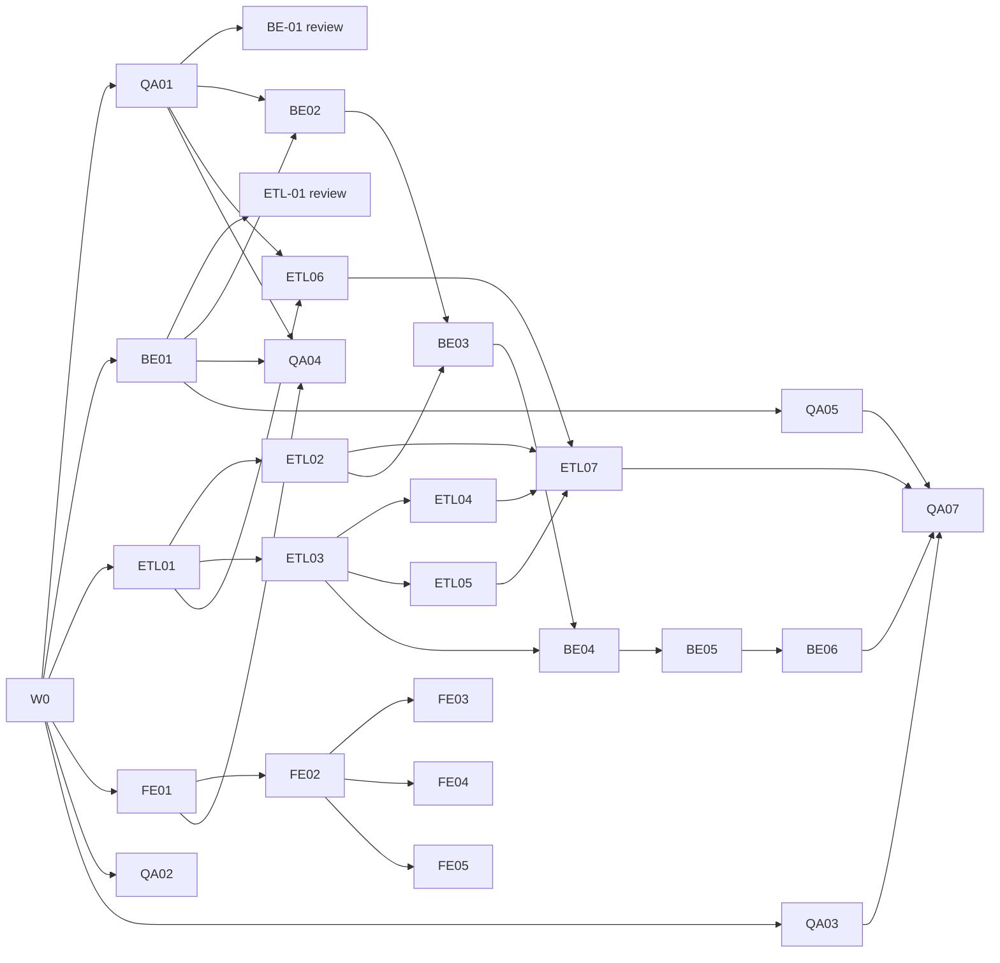

# LocalETL Task Board

Maintained by the orchestrator on `main` only. Agents never edit this file; they report status in their completion report.
Execution model: **Option B**, one Claude Code session per agent, each in its own Git worktree.

## Status legend

| Status | Meaning |
|---|---|
| Blocked | At least one dependency is not Done |
| Ready | All dependencies Done; may start |
| In progress | Agent working on it |
| In review | Branch submitted; awaiting QA verdict and orchestrator review |
| Done | Merged to `main`, full suite green on `main` |

A dependency is **Done only when its deliverables are merged to `main`**. "Before review" dependencies let coding start early but must be Done before the ticket can be submitted.

---

## Wave 0: Foundation (orchestrator)

| ID | Deliverable | Files | Acceptance criteria | Status |
|---|---|---|---|---|
| W0-01 | Project rules | `CLAUDE.md` | Mission, source-of-truth precedence, engineering rules, ownership, interface rules, git workflow, commands, completion report | Done (foundation commit) |
| W0-02 | Requirements | `docs/requirements.md` | Numbered REQ-01…REQ-64 covering every MVP scope item; limits; non-goals | Done (foundation commit) |
| W0-03 | Architecture + internal interfaces | `docs/architecture.md`, `.env.example` | Components, toolchain, ownership table, import rules, env vars, ETL engine interface (§5), semantic config rules (§6), DB schema + run state machine (§7) | Done (foundation commit) |
| W0-04 | Pipeline config contract | `contracts/pipeline.schema.json`, `contracts/examples/pipeline/{valid,invalid}/` | Draft 2020-12; fixed op and rule enums; 3 valid and 8 invalid examples behave as labelled | Done (foundation commit) |
| W0-05 | HTTP contract | `contracts/openapi.yaml` | OpenAPI 3.1, 22 operations, shared `Error`; references pipeline schema instead of duplicating it; Redocly lint 0 errors; `openapi-typescript` generates types | Done (foundation commit) |
| W0-06 | Specialist agents | `.claude/agents/*.md` (6) | Frontmatter on line 1; owned paths match architecture §3 | Done (foundation commit) |
| W0-07 | Task board + assignments | `docs/task-board.md`, `docs/assignments/*.md`, `docs/wave-1-runbook.md` | Every ticket has owner, dependencies, files, acceptance criteria, status | Done (foundation commit) |
| W0-08 | Consistency check | `contracts/tools/check_contracts.py`, `.gitignore` | Cross-checks enums, refs, examples, required fields and ownership across contracts and docs; 0 failures | Done (foundation commit) |

Foundation commit: see "Foundation record" at the end of this file.

---

## Wave 1: Core implementation

Owners: ETL → `etl-engineer` (worktree `agent-etl`), BE → `backend-engineer` (`agent-backend`), FE → `frontend-engineer` (`agent-frontend`), QA → `qa-engineer` (`agent-qa`).
Wave 2 (worker, visualization, browser E2E) is listed at the end and is not assigned yet.

### ETL engine: `backend/app/etl/`, `backend/tests/etl/`

| ID | Title | Depends on | Files to modify | Acceptance criteria | Status |
|---|---|---|---|---|---|
| ETL-01 | Public types, errors and interface stubs | W0 · *before review:* BE-01 | `backend/app/etl/__init__.py`, `types.py`, `errors.py`; `backend/tests/etl/test_public_api.py` | Every name in architecture §5 exported with exact signatures and full type hints (functions may raise `NotImplementedError`); dataclasses frozen; test asserts the export list; `mypy --strict backend/app/etl` passes; import-rule test (no FastAPI/`app.*` imports); **Row accounting (Q3, architecture §5):** `RunResult` has exactly `extracted_count, loaded_count, rejected_count, duplicate_dropped_count, null_dropped_count` before `rejected_sample`; new public `RunCounters` (same five fields, same order); `StageEvent` gains a final field `counters: RunCounters`; export-list and field-order tests updated | **Done**: merged `0253f17` (rebased code commit `f1328c5`, was `dd6c370`; checkpoint commit `04b4b3a` not merged). Interface design approved by user 2026-10-20 |
| ETL-02 | CSV inspect and preview | ETL-01 | `backend/app/etl/extract.py`, `backend/tests/etl/test_extract.py` | `inspect_csv` / `preview_csv` per §5; all 4 encodings and 4 delimiters; `has_header=false` naming; type inference for all 6 `ColumnType`s; `CsvFormatError` for every REQ-04 case; chunked reading | Blocked (**Q4 decision**: duplicate headers, ragged rows; ETL-01 Done) |
| ETL-03 | Config validation | ETL-01 | `backend/app/etl/config.py`, `backend/tests/etl/test_config.py` | Loads `contracts/pipeline.schema.json` from the path in §5; all examples in `contracts/examples/pipeline/` behave as labelled; each semantic rule in §6 has a passing and a failing test; errors collected with JSON Pointer paths | **Done**: merged `3091750` (code commit `0f56443`, QA PASS `d357794`; Q6-1 resolved by contract `f42db38`) |
| ETL-04 | Transform stage | ETL-03 | `backend/app/etl/transform.py`, `backend/tests/etl/test_transform.py` | Column select/rename; casting per §5 stage 2 with `type_cast`/`not_null` rejections; ordered registry with exactly the 7 schema ops (completeness test against the schema enum); `deduplicate` across chunks; no `eval`/`exec`/`DataFrame.query`/`DataFrame.eval`; **Row accounting (Q3, architecture §5):** cast and `nullable` failures count in `rejected_count`; `deduplicate` → `duplicate_dropped_count`, `drop_null_rows` → `null_dropped_count`, never `rejected_count`; first removal wins (test: `nullable: false` + `drop_null_rows` on the same column → rejected); dedupe keeps the first occurrence across chunk boundaries (test with `chunk_rows=2` and duplicates split across chunks) | Blocked (**casting specification** pending user approval, Q6-3; ETL-03 Done) |
| ETL-05 | Validate stage | ETL-03 | `backend/app/etl/validate.py`, `backend/tests/etl/test_validate.py` | Exactly the 6 schema rules (completeness test); one rejection per failing rule; `unique` across chunks; `fail_run` and `max_rejected_ratio` raise `RejectionLimitExceeded`; regex length cap; **Row accounting (Q3, architecture §5):** a row failing several rules counts once in `rejected_count` with one entry per rule; `unique` passes the first occurrence and rejects later ones across chunks; ratio = `rejected_count / extracted_count` (test: dropped rows do not raise the ratio) | **Ready** (ETL-03 Done; not yet assigned) |
| ETL-06 | Load and publish | ETL-01, QA-01 | `backend/app/etl/load.py`, `backend/tests/etl/test_load.py`, `backend/tests/etl/conftest.py` | Staging table `staging.run_<hex>`; type mapping §7.3 plus `_localetl_*` columns; `replace` and `append` publish in one transaction; append mismatch raises `LoadError`; failure leaves published table unchanged; identifiers validated and quoted; values bound; tests on `TEST_DATABASE_URL` (fixture creates `staging`/`datasets` schemas) incl. hostile names | **Ready** (ETL-01, QA-01 Done) |
| ETL-07 | `run_pipeline` | ETL-02, ETL-04, ETL-05, ETL-06 | `backend/app/etl/runner.py`, `backend/tests/etl/test_runner.py` | Stage order and events per §5; `should_stop` raises `RunInterrupted` and drops staging; **Row accounting (Q3, architecture §5):** for every succeeded run `extracted_count = loaded_count + rejected_count + duplicate_dropped_count + null_dropped_count`, asserted before publish (violation raises `EtlError`, nothing published); identity holds after every chunk; identical counters for `chunk_rows` ∈ {1, 2, 7, 50 000} on the QA-03 fixtures; every `StageEvent.counters` is cumulative and never decreases, at least one `progress` event per chunk, and the final event's counters equal `RunResult`; on failure/interrupt the last event's counters satisfy the chunk invariant and `loaded_count = 0`; matches every count in `tests/fixtures/expected.json`; first 1,000 rejections kept; never writes `public.*`; usable from a plain script (example in module docstring) | Blocked |

### Backend API: `backend/app/{main.py,core,api,models,schemas}`, `backend/migrations/`, `backend/tests/{api,models}/`

| ID | Title | Depends on | Files to modify | Acceptance criteria | Status |
|---|---|---|---|---|---|
| BE-01 | Project scaffold, settings, errors, health | W0 · *before review:* QA-01 | `backend/pyproject.toml`, `backend/app/__init__.py`, `backend/app/main.py`, `backend/app/core/{settings,db,errors}.py`, `backend/app/api/__init__.py`, `backend/app/api/health.py`, `backend/tests/conftest.py`, `backend/tests/api/test_health.py`, `backend/tests/api/test_errors.py` | pyproject declares exactly the libs in architecture §2 (others justified); `pip install -e '.[dev]'` works on Python 3.11; settings from env only; `/api/v1/health` reports `database: ok` against Postgres and `unavailable` when down; 422/404 bodies use contract `Error`; pytest + mypy pass | **Done**: merged `a174f4c` (branch `d45b8c6`) |
| BE-01b | 405 → `method_not_allowed` (decision Q1) | BE-01, contract `b8c6c8f` | `backend/app/core/errors.py`, `backend/tests/api/test_errors.py` | HTTP 405 returns `Error` with `code: method_not_allowed` and the `Allow` header preserved; other unmatched 4xx unchanged; test for `DELETE /api/v1/health`; pytest, mypy, ruff pass | **Done**: merged `68c0ec6` (branch `3c1ca17`) |
| BE-02 | Metadata models and migrations | BE-01, QA-01 | `backend/app/models/*.py`, `backend/alembic.ini`, `backend/migrations/**`, `backend/tests/models/test_migrations.py` | Tables, enum, indexes and FKs exactly per §7.1 (including schemas `staging`, `datasets`); `alembic upgrade head` / `downgrade base` on empty DB; tests prove both partial unique indexes reject a second running run and a second active run per pipeline; **Row accounting (Q3, architecture §5):** five counter columns per §7.1; tests prove the CHECK rejects a `succeeded` run whose counters don't reconcile and a non-succeeded run with `loaded_count > 0` | **Done**: merged `ad52a78` (rebased code commit `b4cd94c`, was `f752a0f`; checkpoint commit `83e1e6c` not merged) |
| BE-03 | Sources endpoints | BE-02, ETL-02 | `backend/app/api/sources.py`, `backend/app/schemas/sources.py`, `backend/tests/api/test_sources.py` | `POST/GET /sources`, `GET/DELETE /sources/{id}`, `GET /sources/{id}/preview` match the contract exactly; streamed upload with 413 before full write; server-generated path `sources/<id>.csv`; 415/422 cases; delete 409 when referenced; uses `app.etl` public names only | Blocked (ETL-02, which waits on Q4; BE-02 Done) |
| BE-04 | Pipelines endpoints | BE-03, ETL-03 | `backend/app/api/pipelines.py`, `backend/app/schemas/pipelines.py`, `backend/tests/api/test_pipelines.py` | CRUD + `POST /pipelines/validate` per contract; validation via `validate_pipeline_config(..., source_columns=...)` only; `config_version` increments on PUT; duplicate name 409; delete with active run 409; `last_run` populated | Blocked (BE-03; ETL-03 Done) |
| BE-05 | Runs endpoints | BE-04 | `backend/app/api/runs.py`, `backend/app/schemas/runs.py`, `backend/tests/api/test_runs.py` | `POST /pipelines/{id}/runs` returns 202 `queued` with snapshot, never executes; 409 on second active run; `GET /runs` filters + pagination; `/runs/{id}`, `/events`, `/rejections` per contract; **Row accounting (Q3, architecture §5):** `Run` returns `extracted_count`, `loaded_count`, `rejected_count`, `duplicate_dropped_count`, `null_dropped_count`; `/rejections` pages entries (a row may have several) | Blocked |
| BE-06 | Datasets and metrics endpoints | BE-05 | `backend/app/api/datasets.py`, `backend/app/api/metrics.py`, `backend/app/schemas/{datasets,metrics}.py`, `backend/tests/api/test_datasets.py`, `backend/tests/api/test_metrics.py`, `backend/tests/api/test_contract_drift.py` | `/datasets`, `/datasets/{id}`, `/rows` (sort validated against registry columns), `/profile`, `/metrics/summary` (zero-filled days; `loaded_count_total` and daily `loaded_count` sum succeeded runs only); `_localetl_*` hidden; drift test: served OpenAPI matches `contracts/openapi.yaml` for all 22 operations | Blocked |

### Frontend: `frontend/` (except `src/features/analytics/`, `src/features/explorer/`)

| ID | Title | Depends on | Files to modify | Acceptance criteria | Status |
|---|---|---|---|---|---|
| FE-01 | Scaffold and app shell | W0 | `frontend/package.json`, `vite.config.ts`, `tsconfig*.json`, `tailwind.config.ts`, `postcss.config.js`, `eslint.config.js`, `index.html`, `src/main.tsx`, `src/app/**` (router, layout, providers, design tokens), `src/test/setup.ts` | Libs per architecture §2 (Recharts installed for Wave 2); TS strict; routes Sources, Pipelines, Runs, Datasets (placeholder), Home; `npm ci`, `test`, `lint`, `build`, `tsc --noEmit` pass | **Done**: merged `ddf63ea` (code commit `27d9ed3`; checkpoint commit `8d0886f` not merged) |
| FE-02 | Generated types, API client, typed mocks | FE-01 | `src/app/api/schema.d.ts` (generated), `src/app/api/client.ts`, `src/app/api/fixtures/**`, `src/app/api/*.test.ts` | Types generated from `contracts/openapi.yaml` with the command in CLAUDE.md; one function per operation used by FE tickets; `Error` body surfaced as typed error; base URL `VITE_API_URL`; mock fixtures typed against generated types; also fix the FE-01 `typecheck` script (F5) | **Ready** (FE-01 Done) |
| FE-03 | Sources: upload and preview | FE-02 | `src/pages/sources/**`, `src/components/sources/**` | Upload with CSV options form and client size check; list with pagination; preview table rendered as text; loading/empty/error states; tests | Blocked |
| FE-04 | Pipeline builder | FE-02 | `src/features/pipelines/**`, `src/pages/pipelines/**` | Builds configs valid against the schema from a source's columns; offers only the 7 ops and 6 rules; reorderable transformations; client checks + `POST /pipelines/validate`, errors shown at their JSON Pointer path; create/edit/delete; tests using the contract examples | Blocked |
| FE-05 | Run controls, monitoring, history | FE-02 | `src/pages/runs/**`, `src/components/runs/**` | Run button (409 shown clearly); run detail with status, stage events, the five Q3 counters (`extracted_count`, `loaded_count`, `rejected_count`, `duplicate_dropped_count`, `null_dropped_count`; drops shown separately from rejections; live while running), rejections table; polling every 2 s that stops at terminal states; history list with pipeline/status filters; metrics as text (charts are Wave 2); tests incl. polling stop | Blocked |

### QA: `tests/`, `scripts/`, `docs/qa/`, `.github/workflows/`, `docker-compose.yml`

| ID | Title | Depends on | Files to modify | Acceptance criteria | Status |
|---|---|---|---|---|---|
| QA-01 | Local dev stack | W0 | `docker-compose.yml`, `scripts/db/init.sql`, `scripts/dev-up.sh`, `scripts/README.md` | `docker compose up -d db` starts Postgres 16 on `127.0.0.1:5432` with healthcheck, creating `localetl` and `localetl_test` from `.env` values; data in a named volume; script waits for healthy | **Done** (`1595bd9`) |
| QA-02 | Test plan and traceability | W0 | `docs/qa/test-plan.md` | Every REQ-xx mapped to tests by layer and ticket; suite commands; Wave 1 exit criteria | Ready |
| QA-03 | Synthetic CSV fixtures | W0 | `tests/fixtures/csv/**`, `tests/fixtures/generate_large.py`, `tests/fixtures/README.md` | Clean orders file matching `orders_full.json`; empty; header-only; BOM; latin-1; `;` `\t` `\|`; ragged rows; duplicate headers; >500 columns; hostile column names; dirty values hitting every rule; large file generated, not committed | **Resubmitted, awaiting orchestrator review; must rebase onto `main` before merge**: Q3 revision `8b3ba0e` (tip `8a9fb50` adds a checkpoint file); pre-check: 20 tests, five Q3 keys only, no legacy `rows_*` |
| QA-03b | Fixtures: Q3 counters | QA-03, Q3 contract | `tests/fixtures/build_fixtures.py`, `tests/fixtures/expected.json`, `tests/fixtures/pipelines/*.json`, `tests/fixtures/test_fixtures.py`, `tests/fixtures/README.md` | `expected.json` uses `extracted_count, loaded_count, rejected_count, duplicate_dropped_count, null_dropped_count` for every scenario (no legacy `rows_*` keys); self-test asserts the identity for every succeeded scenario; **new scenario with `null_dropped_count > 0`** (`drop_null_rows` on a nullable column) and one where duplicates straddle a chunk boundary; regenerated output deterministic | Folded into QA-03 rework |
| QA-04 | CI workflow | QA-01, BE-01, FE-01 | `.github/workflows/ci.yml`, `scripts/test-all.sh` | Runs contract check, Redocly lint, backend pytest (Postgres service) + mypy, frontend test/lint/build; `scripts/test-all.sh` runs the same locally | **Ready** (QA-01, BE-01, FE-01 Done) |
| QA-05 | API conformance harness | BE-01 · extended after each BE merge | `tests/integration/conftest.py`, `tests/integration/test_api_conformance.py` | Validates live responses (status + body) against `contracts/openapi.yaml` for every merged endpoint, including error bodies | **Ready** (BE-01 Done; covers `/health` and error bodies now) |
| QA-06 | Review gate | each ticket In review | `docs/qa/reviews/<TICKET-ID>.md` | Per ticket: PASS/FAIL, suites run with counts, ownership check, CLAUDE.md rules check, defects with repro | Ongoing |
| QA-07 | Wave 1 integration (exit gate) | ETL-07, BE-06, QA-03, QA-05 | `tests/integration/test_wave1_flow.py` | Via API: upload fixture → preview → create pipeline → validate → queue run (`queued`, 409 on second). Direct `run_pipeline` on the same snapshot: `replace` and `append` row counts in `datasets.*` match fixture expectations; **Row accounting (Q3, architecture §5):** for every succeeded scenario the five counters equal `expected.json` and reconcile, and `SELECT count(*)` of the published rows written by the run equals `loaded_count`; failing pipeline publishes nothing; interrupted run drops staging | Blocked |

---

## Start readiness after the foundation commit

| Agent | Can resume now with | Then |
|---|---|---|
| etl-engineer | **ETL-01**: rebase + submit now | ETL-03 → ETL-02 → ETL-04/ETL-05 → ETL-06 (needs QA-01) → ETL-07 |
| backend-engineer | ~~BE-01~~ Done → **BE-01b**, then **BE-02** | BE-03 → BE-04 → BE-05 → BE-06 |
| frontend-engineer | **FE-01** | FE-02 → FE-03 / FE-04 / FE-05 |
| qa-engineer | **QA-01** first (unblocks DB work), then QA-03, QA-02 | QA-04, QA-05, QA-06 reviews, QA-07 |

All four agents can resume immediately. Every other ticket is Blocked until its dependencies merge.

Critical path: QA-01 → BE-01 → BE-02 → BE-03 → BE-04 → BE-05 → BE-06 → QA-07 (ETL-02/03 must land before BE-03/BE-04).

## Wave 2 (not assigned yet)

WK-01 claim/heartbeat/recovery loop · WK-02 run execution and success/failure transactions · WK-03 signal handling · VIZ-01 run metrics charts · VIZ-02 dataset explorer with profile charts · QA-08 Playwright E2E demo (MVP gate). Depends on Wave 1 exit (QA-07 PASS).

## Review log

| Ticket | Branch / commits | Merge | Reviewer | Verdict | Evidence | Follow-ups |
|---|---|---|---|---|---|---|
| QA-01 | `qa/QA-01-dev-stack` @ `61573e6` | `1595bd9` | orchestrator (QA cannot review its own ticket) | PASS | `docker compose config` valid; contract check 0 failures; with `POSTGRES_PORT=55432` the stack was healthy in 6.6 s; `localetl` and `localetl_test` reachable over TCP immediately after healthy; port bound to `127.0.0.1` only; named volume; review stack torn down afterwards | F1, F2 |
| BE-01 | `be/BE-01-scaffold` @ `d45b8c6` (2 commits; identical code to `a2b98ba`) | **`a174f4c`** | qa-engineer (`docs/qa/reviews/BE-01.md`, `691a280`: PASS; first pass `53570a1`: changes requested, rebase only) + orchestrator | PASS | On the merged tree (`9009372`, identical to the committed `main` tree), fresh venv, Python 3.11.6, Postgres 16 on 55432: pytest 8 passed / 0 skipped (from `backend/` and repo root); mypy clean; ruff check + format clean; check_contracts 0 failures; live `/api/v1/health` → ok; unknown route → contract 404 | Q1 → BE-01b; F3 |
| BE-01b | `be/BE-01b-method-not-allowed` @ `3c1ca17` (1 commit; reviewed without rebase under the runbook exception) | **`68c0ec6`** | qa-engineer (`docs/qa/reviews/BE-01b.md`, `76240a8` on `qa/QA-06-reviews`: PASS) + orchestrator | PASS | Trial merge into `ebcd928`: 0 conflicts; check_contracts 0 failures; fresh venv, Python 3.11.6, Postgres 16 on 55432: pytest 9 passed / 0 skipped (from `backend/` and repo root; baseline `main` 8); mypy clean (8 files); ruff check + format clean | F4 |
| FE-01 | `fe/FE-01-scaffold` @ `27d9ed3` (code commit; tip `8d0886f` adds only the agent checkpoint file, not merged; reviewed without rebase under the runbook exception) | **`ddf63ea`** | qa-engineer (`docs/qa/reviews/FE-01.md`, `76240a8` on `qa/QA-06-reviews`: PASS) + orchestrator | PASS | Trial merge into `0d24f21`: 0 conflicts, 26 files all under `frontend/`; Node 23.7.0: `npm ci` OK; vitest 7 passed; eslint clean; `tsc --noEmit -p tsconfig.app.json` and `-p tsconfig.node.json` OK; `vite build` OK (209.75 kB JS / 7.46 kB CSS); check_contracts 0 failures; backend pytest 9 passed; `npm audit --omit=dev`: 2 moderate (react-router 6.x, known) | F5, F6 |
| ETL-01 | `etl/ETL-01-public-types` rebased onto `a07cbb0`: code commit `f1328c5` (range-diff identical to pre-rebase `dd6c370`; backup branch `etl/ETL-01-public-types-prerebase` @ `dcfc4d8`); tip `04b4b3a` adds only the agent checkpoint file, not merged | **`0253f17`** | user (interface design, 2026-10-20) + qa-engineer (`docs/qa/reviews/ETL-01.md`, `b0463ff` on `qa/QA-06-reviews`: independent re-review, PASS; supersedes the pre-Q3 review of `8b23e75`) + orchestrator | PASS | Trial merge into `a07cbb0`: 0 conflicts, 7 files all under `backend/app/etl/` and `backend/tests/etl/`; Python 3.11.6, Postgres 16 on 55432: check_contracts 0 failures; pytest 27 passed (ETL 18, API 9; from `backend/` and repo root); mypy app clean (14 files); mypy --strict app/etl clean (6 files); ruff check + format clean; `import app.etl` loads no FastAPI/pydantic/`app.*` modules; no parent-relative imports | F7 |
| BE-02 | `be/BE-02-models-migrations` rebased onto `7d2d7b6`: code commit `b4cd94c` (range-diff identical to `f752a0f`; backup branch `be/BE-02-models-migrations-prerebase` @ `2961361`); tip `83e1e6c` adds only the agent checkpoint file, not merged | **`ad52a78`** | qa-engineer (`docs/qa/reviews/BE-02.md`, `cc342c5` on `qa/QA-06-reviews`: PASS; own scratch-DB checks of both CHECKs and partial indexes via `pg_constraint`/`pg_indexes`) + orchestrator | PASS | Trial merge into `7d2d7b6`: 0 conflicts, 11 files all backend-owned; no value-interpolated SQL (only test-generated, quoted scratch DB names in `tests/models/conftest.py`); DB URL from settings/env only; Python 3.11.6, Postgres 16 on 55432: check_contracts 0 failures; pytest 56 passed (ETL 18, API 9, models 29); mypy clean (18 files); mypy --strict app/etl clean; ruff clean; alembic upgrade → downgrade → upgrade OK; `alembic check`: no drift; `localetl_test` left at base | F9 |
| ETL-03 | `etl/ETL-03-config-validation` @ `0f56443` (rebased onto `65b093f`, range-diff identical to `c85c504`; backup `-prerebase` @ `c85c504`); merged without a further rebase on user instruction (main had moved only by a board commit and contract `f42db38`, no file overlap) | **`3091750`** | qa-engineer (`docs/qa/reviews/ETL-03.md`, `d357794` on `qa/QA-06-reviews`: PASS, 6 needs-ruling items → Q6) + user (Q6-1 Option A) + orchestrator | PASS | Trial merge into `f42db38`: 0 conflicts, 2 files; check_contracts 0 failures; pytest 102 passed (ETL 64, API 9, models 29); mypy clean (18 files); mypy --strict app/etl clean; ruff clean; probe on the merged validator: `format` rejected at `/columns/0/format` for string/integer/float/boolean, accepted for date/datetime; no eval/exec/query; `app.etl` import isolation holds | Q6-2…6 |

| ID | Follow-up | Owner | Blocking? |
|---|---|---|---|
| F1 | **This machine runs Postgres.app 13 on `127.0.0.1:5432`**, so `scripts/dev-up.sh` fails with "address already in use" on defaults (verified). Fix locally: either quit Postgres.app, or create `.env` with `POSTGRES_PORT=55432` and change the port in `DATABASE_URL`/`TEST_DATABASE_URL` to 55432. A misconfigured client fails loudly (`role "localetl" does not exist`), not silently. | user / every agent | Yes, for any DB test on this machine |
| F3 | `backend/pyproject.toml`: no upper bounds on `python-multipart`, `ruff`, `pandas-stubs`; no lockfile (fresh installs get the newest FastAPI/SQLAlchemy). Now orchestrator-owned; revisit with QA-04 CI | orchestrator | No |
| F2 | Healthcheck uses socket `pg_isready`. During first-volume init the image's temporary server is socket-only, so `healthy` could precede `init.sql`. Not reproduced (window ≈ 0.3 s), but change to `pg_isready -h 127.0.0.1 ...` | qa-engineer (with QA-04) | No |
| F4 | pytest shows `StarletteDeprecationWarning` ("Using `httpx` with `starlette.testclient` is deprecated") with the unpinned FastAPI 0.155 / Starlette resolved on 2026-10-20; present on `main` before BE-01b. Pin or migrate with F3 | orchestrator (with QA-04) | No |
| F5 | FE-01 `npm run typecheck` (`tsc --noEmit -p .`) type-checks nothing because root `tsconfig.json` is a solution file; use `tsc -b` or `-p tsconfig.app.json` (QA finding, low) | frontend-engineer (FE-02) | No |
| F6 | `npm audit --omit=dev`: 2 moderate react-router 6.x advisories (open redirect via backslash in `<Link>`/`useNavigate`; SSR `deserializeErrors`). Fix requires Router 7 (breaking). No SSR and no API-derived link targets yet; revisit before FE tickets build links from API data | orchestrator | No |
| F7 | `test_import_rules` skips all relative imports (level > 0), so `from ..models import X` would pass while breaking the import rule. No violation today (verified). Reject level ≥ 2 in the test (QA finding, low) | etl-engineer (with ETL-03) | No |
| F8 | `docker-compose.yml` hard-codes `container_name: localetl-db`, so a `COMPOSE_PROJECT_NAME=localetlreview` review stack cannot run beside the dev stack. Reviews currently share the dev stack on 55432 sequentially. Drop `container_name` | qa-engineer (with QA-04) | No |
| F9 | Model tests create scratch databases, so the DB role needs `CREATEDB` (true for the compose superuser; must hold for the CI Postgres service). Info notes from QA: no non-negative CHECK on counters (not required by §7.1); `Run.status` default is server-side only | qa-engineer (QA-04) | No |

## Agent status snapshot (superseded)

**Current state: see `docs/checkpoints/SESSION_HANDOFF.md` (2026-10-19 session end).** The table below is historical.

### 2026-10-19, after BE-01 merge

Verified from git and local session metadata. Test results are **agent-reported** until a reviewer re-runs them.

| Agent | Worktree | Branch @ commit | Ticket | Rebased on `main` | Files outside owned paths | Agent-reported tests |
|---|---|---|---|---|---|---|
| backend-engineer | `agent-backend` | `be/BE-01-scaffold` @ `d45b8c6` | BE-01 → **merged `a174f4c`** | n/a | none (14 files) | verified by QA and orchestrator (see Review log) |
| etl-engineer | `agent-etl` | `etl/ETL-01-public-types` @ `6a87211` | ETL-01 | **no** (needs rebase onto `b8c6c8f`+) | none (7 files) | pytest 17 passed; mypy --strict clean (temporary venv) |
| frontend-engineer | `agent-frontend` | `fe/FE-01-scaffold` @ `41efb4b` | FE-01 | **no (3 behind)** | none (26 files) | vitest 7 passed; lint, build, tsc OK |
| qa-engineer | `agent-qa` | `qa/QA-03-fixtures` @ `a3ff6f3` | QA-03 | yes | none (33 files, largest 12.5 KB) | pytest tests/fixtures 13 passed |

## Open questions raised in agent reports

| ID | From | Question | Affects / decision |
|---|---|---|---|
| Q1 | BE-01 | `Error.code` has no value for 405 and similar statuses | **Decided 2026-10-19 (user approved):** add `method_not_allowed` for HTTP 405. Contract changed in `b8c6c8f`; implementation in BE-01b |
| Q2 | BE-01 | Validation paths drop the `body`/`query` prefix; multipart field naming for BE-03 | BE-03 |
| Q3 | QA-03 | Do rows dropped by `deduplicate` / `drop_null_rows` count as rejected? | **Decided 2026-10-19 (user approved): no.** Five counters with a reconciliation identity, architecture §5 "Row outcome accounting". Approved design `7ed2883` + validation fixes `9b072f5` (user chose cumulative `RunCounters` on every `StageEvent`), **merged `3572cf8`**. ETL-04 stays blocked until the revised ETL interface (ETL-01 rework) is approved. Affects ETL-01 (rework), ETL-04/05/07, BE-02/05/06, FE-05, QA-03b, QA-07 |
| Q4 | QA-03 | Behaviour for duplicate CSV headers and ragged rows is unspecified | architecture §5, ETL-02 |
| Q5 | QA-03 | `unique` can never fire after `deduplicate` on the same key in `orders_full.json` (by design; QA added a variant) | none, informational |
| Q6 | ETL-03 | Interpretations in `validate_pipeline_config`: (1) schema errors stop §6 rules (two phases); (2) schema says `format` is "ignored for other types" but §6 rule 7 forbids it outside date/datetime: implemented §6 (stricter); contracts outrank architecture, so wording must be reconciled; (3) "castable" defined privately (integer/float/boolean/date/datetime rules; date without `format` = ISO 8601) and ETL-04 casting must match; (4) range-bound typing for date/datetime; (5) not enforced: length min > max, strptime format validity, duplicate validations, `replace_values` value types, `fill_null` on non-nullable; (6) rule 2 extended to every column reference | ETL-03 merge, ETL-04, possibly schema description · QA (`d357794`) confirms all six as spec gaps, not defects; adds: date parsing via lax `fromisoformat`; string `"1.0"` not castable to integer while number `1.0` is; tz-aware/naive bound mix rejected (§6 rule 4 already requires ISO 8601 bounds). Info: missing schema file raises bare `OSError`; bad strptime format gives a misleading "cannot be cast" message. **Q6-1 blocks the ETL-03 merge**: `pipeline.schema.json` `format` says "Ignored for other types"; architecture §6 rule 7 says "allowed only on `date`/`datetime`" · **Q6-1 decided 2026-10-20 (user): Option A**, contract wording changed in `f42db38`; ETL-03 merged `3091750`. Q6-3 (casting) → written specification for approval before ETL-04. Q6-2, 4, 5, 6 open |

## Process notes

- **Runbook exception (user approved 2026-10-19):** BE-01b, FE-01 and QA-03 may be QA-reviewed at their existing commits without rebasing, *if their changes are unaffected by Q3*. Before any of them merges, the orchestrator still verifies a clean integration with current `main`, contract compatibility, and the relevant tests on the integrated result, and requests a rebase or changes otherwise. Pre-check against `3572cf8`: BE-01b and FE-01 qualify; QA-03 no longer does (see its status).

## Shared-file rules

Orchestrator only: `CLAUDE.md`, `contracts/**`, `docs/*.md` (not `docs/qa/`), `docs/assignments/`, `.claude/agents/`, `.env.example`, `.gitignore`, `README.md`, `backend/pyproject.toml` after BE-01 merges. Agents propose changes in their completion report.

## Risks

| ID | Risk | Mitigation |
|---|---|---|
| R1 | Agent sessions keep stale instructions in memory after the worktree is updated | Restart every session after sync (runbook step 3) |
| R2 | Backend router registration in `app/main.py` conflicts between BE tickets | BE tickets are sequential; each rebases before review |
| R3 | ETL tests need `backend/pyproject.toml` before BE-01 merges | ETL may use a temporary local venv; must pass via the real pyproject before review |
| R4 | `regex` rule is a ReDoS vector | Pattern ≤ 200 chars, value ≤ 10,000 chars (schema + ETL-05); revisit with `re2` if needed |

## Foundation record

| Item | Value |
|---|---|
| Foundation commit | `6749842e64ab8ba6ebb2b70d378f55c7826bfe60` (`6749842`, "Wave 0: project foundation") |
| Parent | `e3f1bc9` initialize LocalETL project |
| Date | 2026-10-19 |
| Checks at commit | `contracts/tools/check_contracts.py`: 0 failures · Redocly lint: 0 errors (8 cosmetic warnings) · `openapi-typescript` generation OK |
